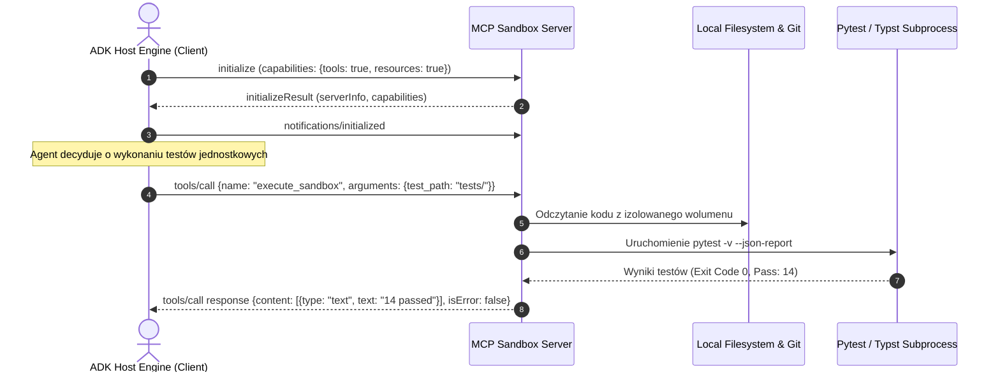

# Scientific Paper Dossier: Model Context Protocol (MCP) Specification

> **Citation Key:** `@AnthropicMCP2024`  
> **Authors:** Anthropic Engineering Team  
> **Affiliations:** Anthropic PBC  
> **Publication Year:** 2024 *(Max 3-year SOTA Horizon)*  
> **Citations Count:** ~600+ (kluczowy standard branżowy)  
> **Venue / Conference:** Anthropic Open Source Technical Specification  
> **Link / DOI:** [https://modelcontextprotocol.io](https://modelcontextprotocol.io)  
> **Code Artifact:** [https://github.com/modelcontextprotocol](https://github.com/modelcontextprotocol)

---

## 📌 1. Core Thesis and Research Motivation

Do końca 2024 roku rozwój systemów agentowych był paraliżowany przez **skrajną fragmentację interfejsów narzędziowych**. Każda biblioteka (LangChain, LlamaIndex, AutoGen, CrewAI) tworzyła własne, niekompatybilne ze sobą wrappery narzędzi i mechanizmy dostępu do danych. Prowadziło to do powielania podatności bezpieczeństwa, braku izolacji uprawnień oraz niemożności reużywania serwerów narzędziowych pomiędzy różnymi modelami LLM.

**Model Context Protocol (MCP)** wprowadza **otwarty standard protokołu klient-serwer**, wzorowany na sukcesie *Language Server Protocol (LSP)* w środowiskach IDE. MCP ujednolica komunikację pomiędzy modelami AI (klientami/hostami) a zewnętrznymi zasobami danych i narzędziami (serwerami MCP) za pośrednictwem ustrukturyzowanych komunikatów JSON-RPC 2.0.

---

## 💡 2. Formalization & Protocol Architecture

MCP definiuje ścisłą architekturę trójwarstwową opartą na trzech podstawowych prymitywach protokołu:

### 1. Trzy Prymitywy Architektury MCP
1. **Resources (Zasoby):** Pasywne, kontrolowane przez serwer źródła danych (odpowiednik żądań `GET`), identyfikowane za pomocą schematu URI (np. `file:///repo/src/main.py`, `git://diff/head`).
2. **Prompts (Szablony Promptów):** Wstępnie zdefiniowane, parametryzowane szablony zapytań z walidacją argumentów, ułatwiające standaryzację ról agentowych.
3. **Tools (Narzędzia):** Aktywne funkcje ze skutkami ubocznymi (side effects), umożliwiające modyfikację środowiska (odpowiednik żądań `POST`), posiadające schemat wejściowy zdefiniowany w standardzie JSON Schema.

### 2. Cykl Życia Sesji i Negocjacja Zdolności (Capabilities Negotiation)
Komunikacja rozpoczyna się od fazy uzgodnienia zdolności:
$$\operatorname{InitSession} = \langle \mathcal{C}_{\text{client}}, \mathcal{C}_{\text{server}} \rangle$$
gdzie wektor zdolności $\mathcal{C}$ obejmuje m.in.:
$$\mathcal{C} = \big\{ \text{roots: list\_changed}, \; \text{sampling: create\_message}, \; \text{tools: list\_changed}, \; \text{logging: set\_level} \big\}$$

Każde wywołanie narzędzia ma deterministyczny format żądania JSON-RPC:
$$\operatorname{CallToolRequest} = \big\{ \text{"method"}: \text{"tools/call"}, \; \text{"params"}: \{ \text{"name"}: t_{\text{name}}, \; \text{"arguments"}: \mathbf{a} \} \big\}$$
zwracając odpowiedź spełniającą kontrakt:
$$\operatorname{CallToolResponse} = \big\{ \text{"content"}: [ \{ \text{"type"}: \text{"text"|"image"|"resource"}, \; \text{"data"}: \dots \} ], \; \text{"isError"}: \text{bool} \big\}$$

---

## 🌀 3. MCP Client-Server Interaction Model (Mermaid)

---

## ⚖️ 4. Empirical & Industry Impact

Jako globalny standard przemysłowy wprowadzony pod koniec 2024 roku, MCP przyniósł wymierne korzyści inżynieryjne:
1. **Reużywalność Narzędzi (Zero-Glue Code):**
   - Narzędzie zaimplementowane jako serwer MCP może być bez modyfikacji wywoływane przez Claude Desktop, Cursor, systemy agentowe Python oraz klienty CLI.
2. **Bezpieczeństwo i Izolacja Uprawnień:**
   - Wyeliminowanie wstrzykiwania kodu (code injection) do kontekstu modelu — argumenty narzędzi podlegają natywnej walidacji schematem JSON Schema przed jakimkolwiek wykonaniem.
3. **Wsparcie dla Wielkich Zasobów (Context Streaming):**
   - Rozdzielenie metadanych zasobu od jego zawartości umożliwia agentom listowanie tysięcy plików w ułamku sekundy i pobieranie wyłącznie wycinków tekstu.

---

## 🛠️ 5. Actionable Implementation Mapping in ADK

W architekturze ADK wzorzec MCP stanowi fundament integracji całego podsystemu narzędziowego:

| Koncepcja MCP | Odpowiednik w ADK | Ścieżka w repozytorium |
| :--- | :--- | :--- |
| **Tool Registry & Discovery** | Dynamiczny rejestr narzędzi z autodetekcją | [`adk/tool_registry.py`](file:///d:/studia-local/Artificial-Degree-Printer/adk/tool_registry.py) |
| **JSON Schema Tool Contract** | Modele parametrów Pydantic v2 dziedziczące z `BaseTool` | [`adk/tools/base.py`](file:///d:/studia-local/Artificial-Degree-Printer/adk/tools/base.py) |
| **Narzędzie Sandboksa (Tools)** | Izolowane środowisko wykonawcze procesów | [`adk/tools/sandbox.py`](file:///d:/studia-local/Artificial-Degree-Printer/adk/tools/sandbox.py) |
| **Narzędzie Kontroli Wersji** | Narzędzie wersjonowania Git Provenance | [`adk/tools/git_tool.py`](file:///d:/studia-local/Artificial-Degree-Printer/adk/tools/git_tool.py) |
| **Zarządzanie Zasobami (Resources)** | Narzędzia odczytu i parsowania literatury naukowej | [`adk/tools/literature.py`](file:///d:/studia-local/Artificial-Degree-Printer/adk/tools/literature.py) oraz [`doc_scraper.py`](file:///d:/studia-local/Artificial-Degree-Printer/adk/tools/doc_scraper.py) |

---

## 🚀 6. Strengths, Limitations & How ADK Advances Beyond MCP

### Kluczowe zalety MCP:
- Jednolity, elegancki protokół eliminujący chaos bibliotek pośredniczących.
- Pełna separacja środowiska wykonawczego od modelu językowego.
- Skalowalność do architektur rozproszonych (transport SSE/HTTP).

### Ograniczenia i specyfika MCP:
- **Protokół jest agnostyczny domenowo:** Sam protokół MCP nie wie, czym jest praca naukowa, kompilacja Typst/LaTeX, testy mutacyjne czy stylometria akademicka.
- **Brak wewnętrznej logiki weryfikacji:** MCP odpowiada wyłącznie za transport zapytań i odpowiedzi; poprawność merytoryczna pozostaje poza protokołem.

### 🎯 Jak ADK rozbudowuje możliwości MCP:
1. **Specjalizowane Serwery Domenowe:** ADK buduje dedykowane narzędzia akademickie (`TypesettingTool`, `StylometryGate`, `MutationGate`) operujące zgodnie ze standardami schematów MCP.
2. **Automatyczne Generowanie Dowodów Wykonania (Audit Trail):** Każde wywołanie narzędzia zgodnego z MCP jest logowane w repozytorium projektu w formacie JSON wraz z sumą kontrolną, stanowiąc niezaprzeczalny dowód empiryczny dla rozdziału badawczego pracy dyplomowej.

---

## 📚 7. Mapping to Thesis Chapters

- **Rozdział 2 (Stan Wiedzy):** Sekcja 2.3 *Model Context Protocol (MCP)* — charakterystyka standardu integracji narzędzi.
- **Rozdział 3 (Architektura Systemu):** Sekcja 3.2 *Interfejs Narzędziowy i Standaryzacja Protokołów*.
- **Rozdział 4 (Implementacja):** Sekcja 4.2 *Zarządzanie Narzędziami i Bezpieczna Piaskownica Wykonawcza*.
