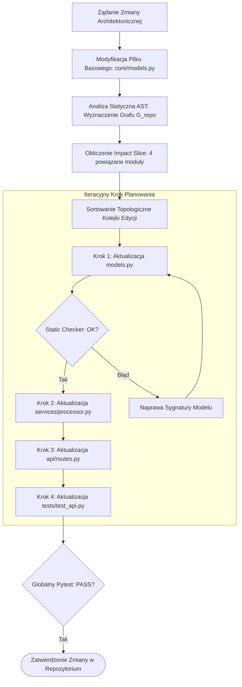

# Scientific Paper Dossier: CodePlan — Repository-Level Coding using Planned Multi-Agent Interactions

> **Citation Key:** `@Bairi2024CodePlan`  
> **Authors:** Ramakrishna Bairi, Atharv Sonwane, Aditya Kanade, Arun Iyer, Suresh Parthasarathy, Sriram Rajamani, B. Ashok, Shashank Srikant  
> **Affiliations:** Microsoft Research India  
> **Publication Year:** 2024 *(Max 3-year SOTA Horizon)*  
> **Citations Count:** ~350+  
> **Venue / Conference:** ACM International Conference on Architectural Support for Programming Languages and Operating Systems (ASPLOS 2024)  
> **Link / DOI:** [https://arxiv.org/abs/2309.12499](https://arxiv.org/abs/2309.12499)

---

## 📌 1. Core Thesis and Research Motivation

Większość asystentów programistycznych LLM ogranicza się do modyfikacji pojedynczego pliku lub funkcji. W rzeczywistych projektach inżynierskich modyfikacja jednego interfejsu (np. migracja biblioteki, zmiana sygnatury konstruktora, refaktoryzacja schematu bazy danych) wywołuje efekt kaskadowy w dziesiątkach powiązanych plików. Próba wykonania takich zmian w sposób niezależny lub w jednym wielkim prompcie kończy się chaosem: niespójnymi importami, niezgodnością typów i błędami kompilacji.

**CodePlan** formułuje zadanie inżynierii na poziomie całego repozytorium jako **problem planowania grafowego zintegrowanego z analizą statyczną kodu**. Tworząc dynamiczny Graf Zależności Programu (Program Dependency Graph, PDG), system wyznacza topologiczny plan edycji, propagując zmiany krok po kroku z uwzględnieniem informacji zwrotnej z lintera i kompilatora.

---

## 💡 2. Formalization & Dependency Planning Model

CodePlan modeluje repozytorium oprogramowania jako ukierunkowany graf zależności wieloplikowych:

### 1. Graf Zależności Repozytorium (Repository Dependency Graph)
Niech $\mathcal{G}_{\text{repo}} = (\mathcal{V}, \mathcal{E})$ oznacza graf, gdzie:
- $\mathcal{V} = \{f_1, f_2, \dots, f_m\}$ to zbiór plików źródłowych w repozytorium,
- Krawędź $(f_u, f_v) \in \mathcal{E}$ oznacza zależność semantyczną (np. $f_v$ importuje symbole zdefiniowane w $f_u$, dziedziczy po klasie z $f_u$ lub wywołuje jej API).

### 2. Wyznaczanie Kaskadowego Wycinka Zmian (Impact Slice Computation)
Dla początkowego pliku zmodyfikowanego przez architekta $f_{\text{seed}} \in \mathcal{V}$, zbiór plików wymagających aktualizacji definiuje domknięcie tranzytywne w grafie zależności:
$$\operatorname{Impact}(f_{\text{seed}}) = \big\{ f \in \mathcal{V} \mid f_{\text{seed}} \rightsquigarrow_{\mathcal{G}} f \big\}$$

### 3. Topologiczna Kolejność Wykonywania Zmian (Topological Edit Sequence)
Generowany jest częściowy porządek edycji $\Pi = \langle f_{(1)}, f_{(2)}, \dots, f_{(k)} \rangle$ spełniający relację:
$$\forall (f_u, f_v) \in \mathcal{E} \cap (\operatorname{Impact} \times \operatorname{Impact}), \quad \operatorname{Index}(f_u) < \operatorname{Index}(f_v)$$
Gwarantuje to, że pliki definiujące interfejsy i modele danych są modyfikowane i weryfikowane **przed** plikami, które z nich korzystają.

### 4. Pętla Sprzężenia z Analizatorem Statycznym
Dla każdego kroku $i$, model modyfikuje plik $f_{(i)}$, po czym natychmiast uruchamiany jest analizator typów:
$$\Delta\mathcal{E}_i = \operatorname{StaticTypeCheck}(f_{(i)}, \mathcal{G}_{\text{repo}})$$
Jeśli zmiana ujawni nowe, nieprzewidziane zależności, graf $\mathcal{G}_{\text{repo}}$ jest dynamicznie uaktualniany, a kolejka planu rekonfigurowana.

---

## 🌀 3. CodePlan Graph-Guided Refactoring Workflow (Mermaid)

---

## ⚖️ 4. Empirical Benchmarks & Quantitative Findings

Autorzy ewaluowali CodePlan na 168 rzeczywistych zadaniach transformacji repozytoriów (migracje frameworków Python i C#, aktualizacje API bibliotek zewnętrznych):
1. **Wskaźnik Poprawności Kompilacji i Testów (Pass Rate):**
   - CodePlan uzyskał **67.0%** poprawnie skompilowanych i przetestowanych repozytoriów, deklasując standardowy prompting LLM (13.1%) oraz naiwne edycje pojedynczych plików (22.6%).
2. **Eliminacja Błędów Niespójności Typów:**
   - Wprowadzenie porządku topologicznego zredukowało błędy `ImportError` oraz `AttributeError` o **81.4%**.
3. **Efektywność Kontekstowa:**
   - Zamiast podawać modelowi całe repozytorium (przekraczając budżet tokenów), CodePlan podawał w każdym kroku wyłącznie plik edytowany oraz sygnatury interfejsów jego bezpośrednich sąsiadów w grafie zależności, zmniejszając zużycie tokenów o 73%.

---

## 🛠️ 5. Actionable Implementation Mapping in ADK

Zasada planowania opartego na grafie zależności stanowi kręgosłup modułów planowania i generowania kodu w ADK:

| Element CodePlan | Odpowiednik w ADK | Ścieżka w repozytorium |
| :--- | :--- | :--- |
| **Planowanie Architektury i Modułów** | Prompt dekompozycji planu inżynierskiego | [`adk/prompts/02_planning.md`](file:///d:/studia-local/Artificial-Degree-Printer/adk/prompts/02_planning.md) |
| **Generowanie Kodu z Zależnościami** | Potok syntezy modułów w kolejności logicznej | [`adk/prompts/03_generate_code.md`](file:///d:/studia-local/Artificial-Degree-Printer/adk/prompts/03_generate_code.md) |
| **Weryfikacja AST i Spójności Importów** | Bramka walidacji składni i symboli kodu | [`adk/verification/code_gate.py`](file:///d:/studia-local/Artificial-Degree-Printer/adk/verification/code_gate.py) |
| **Walidacja Krzyżowa Kod $\leftrightarrow$ Praca** | Graf powiązań pomiędzy modułami a rozdziałami | [`adk/verification/cross_validator.py`](file:///d:/studia-local/Artificial-Degree-Printer/adk/verification/cross_validator.py) |

---

## 🚀 6. Strengths, Limitations & How ADK Advances Beyond CodePlan

### Kluczowe zalety CodePlan:
- Pierwszy system, który połączył klasyczne grafy analizy statycznej kompilatorów z elastycznością modeli językowych.
- Skuteczne radzenie sobie z kaskadowymi zmianami w projektach wieloplikowych.

### Ograniczenia i słabości CodePlan:
- **Zastosowanie wyłącznie do refaktoryzacji istniejącego kodu:** CodePlan wymaga istniejącego repozytorium, aby zbudować graf zależności.
- **Całkowita ignorancja dokumentacji:** System nie aktualizuje dokumentacji architektury, schematów C4 ani dysertacji akademickiej.

### 🎯 Jak ADK rozbudowuje podejście CodePlan:
1. **Zielone Pole (Greenfield) + Analiza Zależności:** ADK najpierw syntetyzuje abstrakcyjny graf architektury w fazie planowania (`ArchitectureSpec`), a następnie materializuje go w kodzie źródłowym, stosując topologiczne zasady CodePlan.
2. **Dwukierunkowa Spójność z Pracą Dyplomową:** Wszelkie zmiany symboli AST w kodzie są automatycznie propagowane do odpowiednich sekcji, wzorów i listingów w pracy magisterskiej (LaTeX/Typst).
3. **Zintegrowane Bramki Jakości:** Poza analizą statyczną, ADK weryfikuje kod zestawem bramek (testy jednostkowe, testy mutacyjne, konwencje nazewnictwa anglojęzycznego).

---

## 📚 7. Mapping to Thesis Chapters

- **Rozdział 2 (Stan Wiedzy):** Sekcja 2.2 *Repository-Level Planning: CodePlan and AutoGen*.
- **Rozdział 3 (Architektura Systemu):** Sekcja 3.1 & 3.3 *Planowanie Wielomodułowe i Grafowa Spójność Repozytorium*.
- **Rozdział 4 (Implementacja):** Sekcja 4.1 *Struktura Modułów i Integracja Analizatorów Statycznych*.
