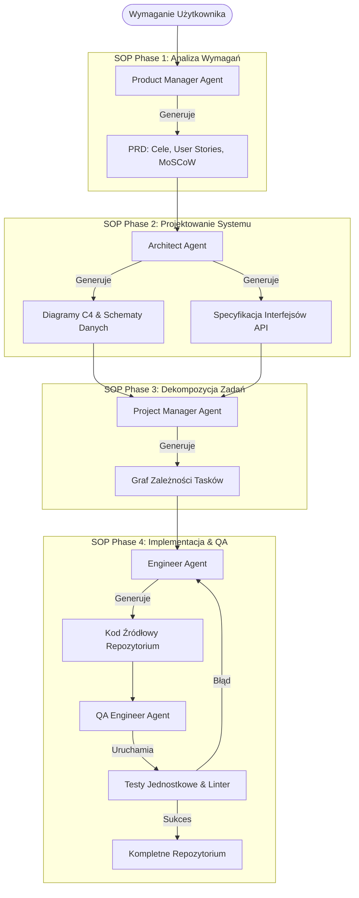

# Scientific Paper Dossier: MetaGPT — Meta Programming for A Multi-Agent Collaborative Framework

> **Citation Key:** `@Hong2024MetaGPT`  
> **Authors:** Sirui Hong, Mingchen Zhuge, Jonathan Chen, Xiawu Zheng, Cheng Gao, Jinlin Wang, Ceyao Zhang, Zili Wang, Steven Hoi, Chenglin Wu  
> **Affiliations:** DeepWisdom, Fudan University, Tsinghua University  
> **Publication Year:** 2024 *(Max 3-year SOTA Horizon)*  
> **Citations Count:** ~1,600+  
> **Venue / Conference:** International Conference on Learning Representations (ICLR 2024)  
> **Link / DOI:** [https://arxiv.org/abs/2308.00352](https://arxiv.org/abs/2308.00352)  
> **Code Artifact:** [https://github.com/geekan/MetaGPT](https://github.com/geekan/MetaGPT)

---

## 📌 1. Core Thesis and Research Motivation

Główną przyczyną niepowodzeń wczesnych systemów wieloagentowych w inżynierii oprogramowania była **anarchia komunikacyjna** — agenci wymieniali niesformatowane wiadomości w czatach wieloosobowych, co prowadziło do ucinania kontekstu, halucynacji sygnatur API i dryfu wymagań (requirement drift).

**MetaGPT** rozwiązuje ten problem poprzez formalne wdrożenie **Standardowych Procedur Operacyjnych (SOPs)** zaczerpniętych z tradycyjnej inżynierii oprogramowania. Kluczowa teza pracy brzmi: *komunikacja między agentami nie powinna opierać się na swobodnej konwersacji, lecz na ustrukturyzowanych dokumentach pośrednich* (Product Requirement Document, diagramy C4, schematy sekwencji i zadania API), które są publishowane do współdzielonej szyny wiadomości (Message Pool) z mechanizmem subskrypcji.

---

## 💡 2. Formalization & Mathematical Model

W architekturze MetaGPT proces inżynieryjny modelowany jest jako ukierunkowany graf przepływu artefaktów (Artifact Flow Graph) sprzężony z mechanizmem publikuj-subskrybuj:

### 1. Model Szyny Komunikacyjnej (Publish-Subscribe Message Pool)
Niech $\mathcal{M}$ oznacza globalny bufor wiadomości, a $\mathcal{R} = \{R_{\text{PM}}, R_{\text{Arch}}, R_{\text{Eng}}, R_{\text{QA}}\}$ zbiór wyspecjalizowanych ról inżynierskich. Każda wiadomość $m \in \mathcal{M}$ ma postać:
$$m = \langle \text{id}, \text{sender}, \text{role}, \text{content}, \text{artifact\_type}, \tau \rangle$$
gdzie $\text{artifact\_type} \in \{\text{PRD}, \text{SystemDesign}, \text{TaskDoc}, \text{Code}, \text{TestReport}\}$.

Funkcja subskrypcji dla roli $R_i$ definiuje selektywne filtrowanie kontekstu:
$$\operatorname{Subscribe}(R_i, \mathcal{M}) = \{ m \in \mathcal{M} \mid \text{artifact\_type}(m) \in \Omega(R_i) \}$$
gdzie $\Omega(R_i)$ to zbiór typów artefaktów wymaganych przez daną rolę (np. architekt subskrybuje wyłącznie `PRD`, ignorując wewnętrzne logi kompilacji kodu).

### 2. Standardowe Procedury Operacyjne (SOP Transformation Function)
Dla każdego etapu $k$, transformacja stanu reprezentowana jest przez funkcję roli:
$$\mathcal{S}_{k+1} = \operatorname{Execute}_{\text{SOP}}\left( R_k, \operatorname{Subscribe}(R_k, \mathcal{M}) \right)$$
pod rygorem schematu walidacyjnego $\mathcal{V}_{\text{schema}}(O_k) \to \{\text{True}, \text{False}\}$, gwarantującego kompletność syntaktyczną (np. obecność diagramu architektury Mermaid i sygnatur endpointów OpenAPI przed rozpoczęciem kodowania).

---

## 🌀 3. Architecture & Artifact Pipeline (Mermaid)

---

## ⚖️ 4. Empirical Benchmarks & Quantitative Findings

Autorzy MetaGPT przetestowali architekturę na benchmarku inżynierii oprogramowania (HumanEval oraz zadaniach budowy kompletnych aplikacji webowych i CLI):
1. **Pass@1 na HumanEval:**
   - MetaGPT osiągnął wynik **85.9%** (z modelem GPT-4), przewyższając AutoGen (68.1%) oraz czysty prompting CoT (67.0%).
2. **Spójność kodu (Code Executability):**
   - W zadaniach generowania wieloplikowych projektów (SoftwareDev Benchmark) MetaGPT osiągnął **100% kompilowalności projektów**, podczas gdy nieskrępowany czat wieloagentowy kończył się błędem w 48% przypadków z powodu niedopasowanych nazw plików i importów.
3. **Efektywność tokenowa:**
   - Dzięki subskrypcji opartej na artefaktach (zamiast powielania pełnego czatu w każdym zapytaniu) zużycie tokenów spadło średnio o **68.5%**.

---

## 🛠️ 5. Actionable Implementation Mapping in ADK

ADK bezpośrednio zaadaptowało i rozwinęło kluczowe elementy koncepcji MetaGPT:

| Koncepcja MetaGPT | Implementacja w ADK | Plik w repozytorium |
| :--- | :--- | :--- |
| **Ustrukturyzowany PRD** | Schemat wymagań i celów badawczych | [`adk/prompts/01_requirements.md`](file:///d:/studia-local/Artificial-Degree-Printer/adk/prompts/01_requirements.md) |
| **Specyfikacja Architektury C4** | Architekt systemu generujący specyfikację techniczną | [`adk/prompts/02_planning.md`](file:///d:/studia-local/Artificial-Degree-Printer/adk/prompts/02_planning.md) |
| **Ścisłe Schematy Typów** | Modele Pydantic v2 dla każdego stanu | [`adk/core/models.py`](file:///d:/studia-local/Artificial-Degree-Printer/adk/core/models.py) |
| **Weryfikacja QA** | Zestaw bramek testowych i mutacyjnych | [`adk/verification/code_gate.py`](file:///d:/studia-local/Artificial-Degree-Printer/adk/verification/code_gate.py) oraz [`mutation_gate.py`](file:///d:/studia-local/Artificial-Degree-Printer/adk/verification/mutation_gate.py) |
| **Diagramy Architektury** | Narzędzie syntezy diagramów Mermaid / CeTZ | [`adk/prompts/06_figures.md`](file:///d:/studia-local/Artificial-Degree-Printer/adk/prompts/06_figures.md) |

---

## 🚀 6. Strengths, Limitations & How ADK Advances Beyond MetaGPT

### Kluczowe zalety MetaGPT:
- Rygorystyczna eliminacja halucynacji dzięki formalnym dokumentom pośrednim.
- Skalowalność do wieloetapowych projektów programistycznych.
- Precyzyjny podział ról inżynierskich wzorowany na metodykach przemysłowych.

### Ograniczenia i słabości MetaGPT:
- **Zorientowanie wyłącznie na miniaturowe projekty (toy software):** MetaGPT generuje zazwyczaj proste aplikacje konsolowe składające się z 2-4 plików.
- **Brak syntezy tekstu naukowego:** Framework nie wspiera generowania akademickiej pracy dyplomowej, bibliografii, aparatu dowodowego ani formatów LaTeX/Typst.
- **Brak testów mutacyjnych:** Sprawdzenie poprawności ogranicza się do powierzchownego uruchomienia testów, bez badania siły testów (Mutation Score).

### 🎯 Jak ADK przekracza osiągnięcia MetaGPT:
1. **Ko-synteza Kodu i Pracy Magisterskiej:** ADK łączy procedury SOP tworzenia oprogramowania ze Standardowymi Procedurami Naukowymi (SNP) — każdy artefakt kodu posiada natychmiastowe odzwierciedlenie w rozdziale pracy dyplomowej.
2. **Formalny Graf Identyfikowalności (Traceability Matrix):** W ADK relacje między wymaganiami, klasami AST a sekcjami pracy są zapisywane w grafie wiedzy, zapobiegając rozbieżnościom faktograficznym.
3. **Bramka Stylometryczna i Antyplagiatowa:** ADK wyposażono w audytora stylometrii zapobiegającego wykryciu syntetyczności tekstu przez algorytmy JSA.

---

## 📚 7. Mapping to Thesis Chapters

- **Rozdział 2 (Stan Wiedzy):** Sekcja 2.2 *Standard Operating Procedures: MetaGPT* — fundamentalne odniesienie do koncepcji procedur SOP w inżynierii agentowej.
- **Rozdział 3 (Architektura Systemu):** Sekcja 3.1 & 3.3 — projektowanie pipeline'u stanowego w oparciu o pośrednie dokumenty architektoniczne.
- **Rozdział 4 (Implementacja):** Sekcja 4.1 *Struktura Modeli i Reprezentacja Stanu Pydantic*.
