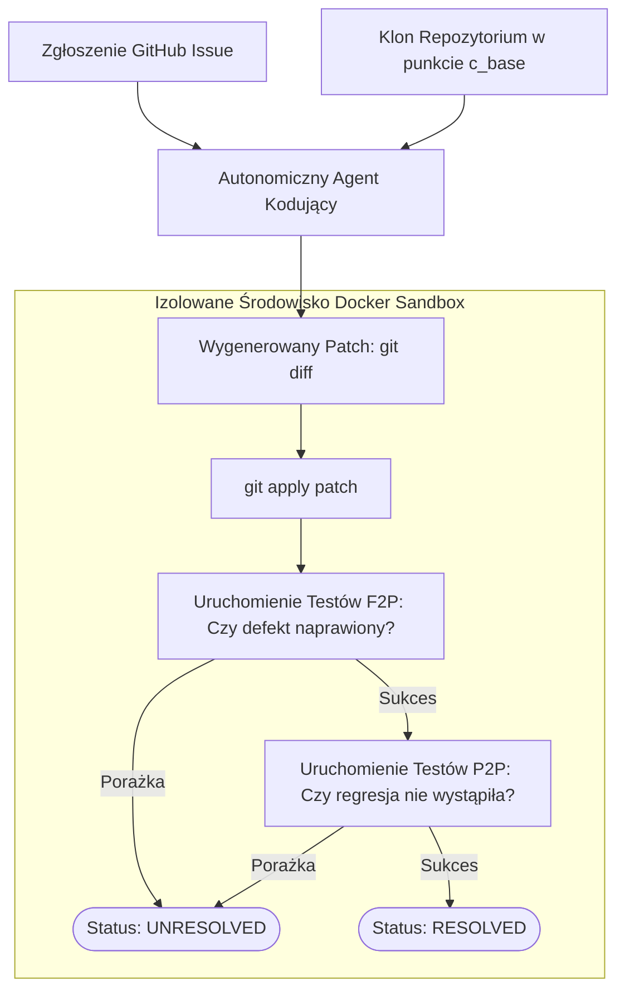

# Scientific Paper Dossier: SWE-bench — Can Language Models Resolve Real-World GitHub Issues?

> **Citation Key:** `@Jimenez2024SWEbench`  
> **Authors:** Carlos E. Jimenez, John Yang, Alexander Wettig, Shunyu Yao, Kexin Pei, Ofir Press, Karthik Narasimhan  
> **Affiliations:** Princeton University  
> **Publication Year:** 2024 *(Max 3-year SOTA Horizon)*  
> **Citations Count:** ~1,500+  
> **Venue / Conference:** International Conference on Learning Representations (ICLR 2024)  
> **Link / DOI:** [https://arxiv.org/abs/2310.06770](https://arxiv.org/abs/2310.06770)  
> **Code Artifact:** [https://github.com/princeton-nlp/SWE-bench](https://github.com/princeton-nlp/SWE-bench)

---

## 📌 1. Core Thesis and Research Motivation

Wcześniejsze benchmarki inżynierii oprogramowania (takie jak HumanEval, MBPP czy CodeContests) oceniały modele językowe w skrajnie uproszczonych, sztucznych warunkach: generowanie pojedynczych funkcji matematycznych lub algorytmicznych na podstawie jednozdaniowych poleceń w języku angielskim. Takie testy nie odzwierciedlały realiów pracy inżyniera oprogramowania: wielotysięcznych repozytoriów, skomplikowanych zależności pakietowych, dziesiątek powiązanych modułów oraz niejednoznacznych zgłoszeń błędów.

**SWE-bench** zrewolucjonizował dziedzinę, wprowadzając **pierwszy wielkoskalowy, empiryczny benchmark oparty na rzeczywistych problemach programistycznych**. Zestaw zawiera 2,294 autentyczne zgłoszenia problemów (Issues) i powiązane z nimi commity typu Pull Request z 12 dojrzałych projektów open-source w języku Python (m.in. Django, scikit-learn, SymPy, Matplotlib, Sphinx, astropy).

---

## 💡 2. Formalization & Evaluation Methodology

Ocena w SWE-bench opiera się na twardej weryfikacji wykonawczej w hermetycznych kontenerach Docker:

### 1. Definicja Zadania Inżynierskiego
Zadanie $I$ składa się z:
- Stanu początkowego repozytorium $\mathcal{R}$ w commicie bazowym $c_{\text{base}}$,
- Tekstowego zgłoszenia problemu (Issue description) $\mathcal{D}_{\text{issue}}$,
- Zestawu testów sprawdzających $\mathcal{T} = \mathcal{T}_{\text{F2P}} \cup \mathcal{T}_{\text{P2P}}$.

### 2. Dwuwarstwowa Weryfikacja Testowa (Fail-to-Pass & Pass-to-Pass)
Niech $\hat{P}$ oznacza wygenerowany przez model patch (w formacie `git diff`). Poprawność łatki wymaga spełnienia koniunkcji dwóch warunków:
$$\operatorname{Resolved}(\hat{P}) \iff \big( \forall t \in \mathcal{T}_{\text{F2P}}, \; \operatorname{Pass}(t, \mathcal{R} \oplus \hat{P}) \big) \;\land\; \big( \forall t \in \mathcal{T}_{\text{P2P}}, \; \operatorname{Pass}(t, \mathcal{R} \oplus \hat{P}) \big)$$
gdzie:
- $\mathcal{T}_{\text{F2P}}$ (*Fail-to-Pass*): testy sprawdzające naprawę defektu (musiały kończyć się niepowodzeniem na $\mathcal{R}$ przed nałożeniem łatki i przejść pomyślnie po nałożeniu $\hat{P}$),
- $\mathcal{T}_{\text{P2P}}$ (*Pass-to-Pass*): testy regresji (muszą przejść bezbłędnie, gwarantując, że łatka nie uszkodziła istniejących funkcjonalności).

---

## 🌀 3. SWE-bench Sandbox Evaluation Pipeline (Mermaid)

---

## ⚖️ 4. Empirical Benchmarks & Quantitative Findings

Wyniki opublikowane w pracy SWE-bench wywołały szok w świecie AI, obnażając bezradność czystych modeli zerostrzałowych (Zero-Shot):
1. **Początkowe Wyniki Czołowych Modeli (Zero-Shot, 2024):**
   - **GPT-4:** rozwiązał zaledwie **1.74%** problemów.
   - **Claude 2:** rozwiązał **4.80%** problemów.
   - Wszystkie otwarte modele (Llama-2, StarCoder) uzyskały wynik **bliski 0%**.
2. **Konieczność Zastosowania Architektury Agentowej:**
   - Praca udowodniła, że sukces na SWE-bench wymaga zaawansowanych mechanizmów wyszukiwania symboli, analizy drzew AST oraz wielokrotnego testowania pośrednich rozwiązań w piaskownicy (co dało początek systemom takim jak SWE-agent, Agentless i Devin, które w latach 2025–2026 osiągnęły wyniki 20–40%).

---

## 🛠️ 5. Actionable Implementation Mapping in ADK

Rygorystyczna metodologia weryfikacji ze SWE-bench została wdrożona w mechanizmach weryfikacji ADK:

| Zasada SWE-bench | Komponent w ADK | Ścieżka w repozytorium |
| :--- | :--- | :--- |
| **Hermetyczne Wykonywanie Testów** | Moduł piaskownicy subprocess/Docker | [`adk/tools/sandbox.py`](file:///d:/studia-local/Artificial-Degree-Printer/adk/tools/sandbox.py) |
| **Weryfikacja Regresji (P2P)** | Bramka poprawności kodu `CodeVerificationGate` | [`adk/verification/code_gate.py`](file:///d:/studia-local/Artificial-Degree-Printer/adk/verification/code_gate.py) |
| **Ewaluacja Test-Driven** | Dynamiczny runner testów Pytest ze zrzutem JSON | [`adk/tools/benchmarks.py`](file:///d:/studia-local/Artificial-Degree-Printer/adk/tools/benchmarks.py) |
| **Wersjonowanie i Śledzenie Zmian** | Śledzenie każdego commitu w repozytorium projektu | [`adk/tools/git_tool.py`](file:///d:/studia-local/Artificial-Degree-Printer/adk/tools/git_tool.py) |

---

## 🚀 6. Strengths, Limitations & How ADK Advances Beyond SWE-bench

### Kluczowe zalety SWE-bench:
- Złoty standard ewaluacji inżynierii oprogramowania oparty na niezależnych testach jednostkowych.
- Pełna odporność na "oszukiwanie" (brak możliwości zdania testów bez faktycznego usunięcia błędu).

### Ograniczenia i słabości SWE-bench:
- **Zadanie czysto naprawcze (Bug-Fixing Only):** SWE-bench bada wyłącznie naprawianie istniejącego kodu. Nie ocenia umiejętności stworzenia nowego systemu od podstaw, zaplanowania bazy danych ani architektury mikroserwisów.
- **Brak badania jakości testów (Mutation Testing Gap):** SWE-bench nie weryfikuje, czy testy napisane przez agenta są silne semantycznie.
- **Brak syntezy dokumentacji akademickiej:** Benchmark nie obejmuje generowania sprawozdania naukowego, opisu matematycznego ani bibliografii.

### 🎯 Jak ADK rozbudowuje metodykę SWE-bench:
1. **Pełny Cykl Greenfield Software Synthesis:** ADK nie tylko naprawia błędy, lecz projektuje i wdraża kompletne systemy od specyfikacji do release'u.
2. **Testy Mutacyjne (Mutation Testing Gate):** Podczas gdy SWE-bench zakłada stałość zestawu testów, ADK wymaga od agenta wygenerowania zestawu testów i poddaje go mutacjom kodu (np. `Mutmut`), wymagając zabicia mutantów na poziomie min. 80%.
3. **Zintegrowany Kompilator Pracy Magisterskiej:** Wyniki testów jednostkowych i mutacyjnych są automatycznie parsowane i wstrzykiwane jako tabele empiryczne do rozdziału 5 i 6 pracy dyplomowej.

---

## 📚 7. Mapping to Thesis Chapters

- **Rozdział 2 (Stan Wiedzy):** Sekcja 2.1 *Evolution of LLM-Driven Software Engineering Agents* — szczegółowe omówienie przełomu wywołanego przez SWE-bench.
- **Rozdział 5 (Bramki Weryfikacyjne):** Sekcja 5.1 & 5.2 *Weryfikacja Kodowa, Piaskownica i Testy Jednostkowe*.
- **Rozdział 6 (Eksperymenty i Ewaluacja):** Sekcja 6.1 *Metodologia Badawcza i Wyniki Uruchomienia Zestawów Testowych*.
