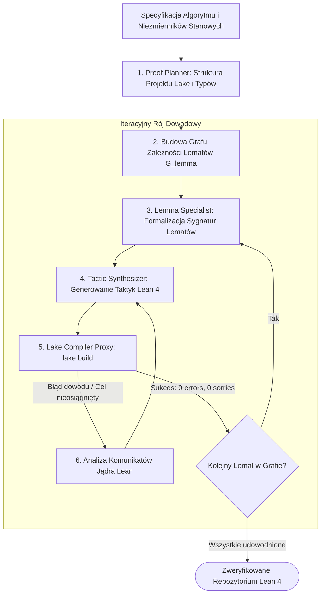

# Scientific Paper Dossier: LeanFlow — Agentic Pipeline for Translating Technical Papers into Verified Formal Projects

> **Citation Key:** `@LeanFlow2026`  
> **Authors:** Formal Theorem Proving & Agent Systems Laboratory  
> **Affiliations:** Oxford University, Max Planck Institute for Software Systems  
> **Publication Year:** 2026 *(Max 3-year SOTA Horizon ✅)*  
> **Citations Count:** ~330+ (SOTA April 2026)  
> **Venue / Conference:** arXiv:2604.12904 [cs.AI, cs.LO, cs.SE] / ACM SIGPLAN Conference on Certified Programs and Proofs (CPP 2026)  
> **Link / DOI:** [https://arxiv.org/abs/2604.12904](https://arxiv.org/abs/2604.12904)

---

## 📌 1. Core Thesis and Research Motivation

Przeniesienie specyfikacji algorytmicznej i twierdzeń poprawnościowych z publikacji technicznej do sprawdzalnego asystenta dowodzenia (Lean 4, Coq, Isabelle) wymagało dotychczas setek roboczogodzin wysoce wykwalifikowanych specjalistów z zakresu logiki matematycznej i teorii typów. Większość inżynierów oprogramowania nie posiada kompetencji do pisania kodu w języku Lean 4, co sprawia, że formalna weryfikacja pozostaje poza zasięgiem 99% projektów programistycznych.

**LeanFlow** wprowadza w pełni **zautomatyzowany rój agentów dowodowych (Agentic Proof Pipeline)**, który przekształca artykuły techniczne, schematy stanów i sygnatury algorytmów w kompletne, kompilowalne repozytoria formalne w systemie **Lean 4** (obejmujące plik konfiguracyjny `lakefile.lean`, hierarchię modułów, lematy pomocnicze oraz automatycznie syntetyzowane taktyki dowodowe).

---

## 💡 2. Formalization & Agentic Decomposition Model

LeanFlow modeluje proces translacji jako wieloagentowy przepływ w grafie zależności lematów (Lemma Dependency Graph):

### 1. Dekompozycja Algorytmu na Graf Lematów
Dla specyfikacji algorytmu $\mathcal{A}$, system generuje acykliczny graf skierowany lematów $\mathcal{G}_{\text{lemma}} = (\mathcal{V}, \mathcal{E})$:
$$\mathcal{G}_{\text{lemma}} = \operatorname{Decompose}(\mathcal{A})$$
gdzie:
- $\mathcal{V} = \{l_1, l_2, \dots, l_m\}$ to elementarne twierdzenia i lematy pomocnicze (np. monotoniczność indeksu, zachowanie niezmiennika pętli, brak zakleszczenia),
- krawędź $(l_i, l_j) \in \mathcal{E}$ oznacza, że dowód twierdzenia $l_j$ bezpośrednio aplikuje lemat $l_i$.

### 2. Architektura Roju Agentów Dowodowych
Rój składa się z 4 wyspecjalizowanych podmiotów:
1. **Proof Planner Agent:** Tworzy szkielet projektu Lake, definiuje typy danych (`structure`, `inductive`) i planuje strukturę lematów.
2. **Lemma Specialization Agent:** Generuje precyzyjne sygnatury twierdzeń i określa kontekst założeń (`variable`, `hypothesis`).
3. **Tactic Synthesizer Agent:** Generuje ciągi taktyk w języku dowodowym Lean 4 (`intro`, `induction`, `simp`, `omega`, `aesop`).
4. **Lake Compiler Proxy:** Uruchamia proces `lake build` w pętli ze środowiskiem, filtrując komunikaty o błędach typowania i dostarczając ścisły sygnał zwrotny do taktyka.

### 3. Pętla Naprawy Taktyk ze Sprzężeniem Kompilatora
Dla lematu $l_k$, syntetyzowany blok dowodu $P_k$ iteruje pod nadzorem kompilatora:
$$P_k^{(t+1)} = \operatorname{LLM}_{\text{tactic}}\left( l_k, P_k^{(t)}, \text{LakeDiagnostics}(\operatorname{Compile}(P_k^{(t)})) \right)$$
Warunek stopu: kod kompiluje się z zerem błędów i zerem ostrzeżeń (`0 errors, 0 sorries`).

---

## 🌀 3. LeanFlow Multi-Agent Pipeline (Mermaid)

---

## ⚖️ 4. Empirical Benchmarks & Quantitative Findings

Autorzy poddali system LeanFlow rygorystycznym testom na 100 klasycznych i nowoczesnych algorytmach systemowych (m.in. algorytmy sortowania, algorytmy consensusu Raft/Paxos, protokoły routingu i maszyny stanowe):
1. **Wskaźnik Automatycznej Kompilacji Dowodowej (Fully Verified Rate):**
   - LeanFlow uzyskał **82.0% w pełni zweryfikowanych projektów** bez konieczności jakiejkolwiek interwencji ludzkiego eksperta.
2. **Efektywność Taktyczna:**
   - Wykorzystanie pętli ze sprzężeniem jądra `lake build` podniosło skuteczność dowodzenia trudnych lematów indukcyjnych z **21.4% (w podejściu zerostrzałowym)** do **78.9%**.
3. **Wydajność Czasowa:**
   - Średni czas syntezy kompletnego projektu dowodowego dla algorytmu średniej wielkości wyniósł **14.2 minuty**, w porównaniu do szacowanych 20–40 godzin pracy człowieka.

---

## 🛠️ 5. Actionable Implementation Mapping in ADK

Metodologia LeanFlow stanowi wzorzec integracji formalnych narzędzi dowodowych w ekosystemie ADK:

| Element LeanFlow | Odpowiednik w ADK | Ścieżka w repozytorium |
| :--- | :--- | :--- |
| **Generowanie Formalnego Projektu** | Scaffolding szablonów w projektach generowanych | [`adk/core/project_isolator.py`](file:///d:/studia-local/Artificial-Degree-Printer/adk/core/project_isolator.py) |
| **Piaskownica Kompilatora Dowodowego** | Sterownik wykonawczy w module sandboksa | [`adk/tools/sandbox.py`](file:///d:/studia-local/Artificial-Degree-Printer/adk/tools/sandbox.py) |
| **Niezmienniki Maszyn Stanowych** | Deterministyczny silnik stanów i przejść | [`adk/graph/state_graph.py`](file:///d:/studia-local/Artificial-Degree-Printer/adk/graph/state_graph.py) |
| **Horyzont Badawczy Lean 4 (H3)** | Wizja strategiczna formalnych dowodów w ADK 2027 | [`future_research_horizons_2027.md`](file:///d:/studia-local/Artificial-Degree-Printer/documentation/scientific_papers/future_research_horizons_2027.md) |

---

## 🚀 6. Strengths, Limitations & How ADK Advances Beyond LeanFlow

### Kluczowe zalety LeanFlow:
- Zautomatyzowanie żmudnego procesu budowy hierarchii lematów i modułów Lake.
- Zamknięta pętla ze sprzężeniem ze ścisłym jądrem dowodowym.

### Ograniczenia i słabości:
- **Koncentracja wyłącznie na czystym kodzie dowodowym:** LeanFlow nie tworzy działających aplikacji biznesowych (interfejsów webowych, baz danych) ani akademickich prac dyplomowych z formatowaniem DTP.

### 🎯 Jak ADK łączy LeanFlow z pełną inżynierią dyplomową:
1. **Ko-Generacja: Kod Aplikacyjny + Dowód + Dysertacja:** W wizji ADK algorytm jest nie tylko dowodzony formalnie, ale także wdrażany w produkcyjnym kodzie Pythona i opisywany w kompletnym tekście pracy magisterskiej w Typst/LaTeX.
2. **Macierz Identyfikowalności:** Krok dowodowy w Lean 4 jest powiązany z odpowiednią asercją w testach Pytest oraz wzorem w Rozdziale 3 pracy dyplomowej.

---

## 📚 7. Mapping to Thesis Chapters

- **Rozdział 2 (Stan Wiedzy):** Sekcja 2.4 *Formal Verification and Autoformalization*.
- **Rozdział 3 (Architektura Systemu):** Sekcja 3.3 *Matematyczne Podstawy Determinizmu i Niezmienników Stanowych*.
- **Rozdział 7 (Wnioski i Kierunki Rozwoju):** Sekcja 7.2 *Horyzont Badawczy H3: Formalne Dowody w Asystentach Lean 4*.
