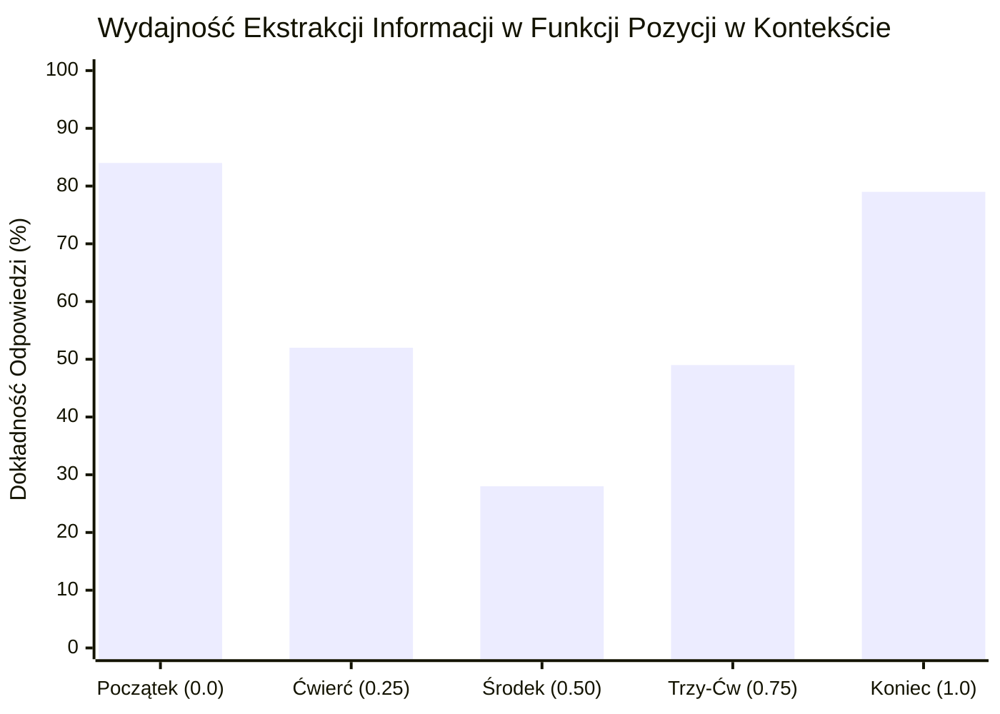

# Scientific Paper Dossier: Lost in the Middle — How Language Models Use Long Contexts

> **Citation Key:** `@Liu2024LostInMiddle`  
> **Authors:** Nelson F. Liu, Kevin Lin, John Hewitt, Ashwin Paranjape, Michele Bevilacqua, Fabio Petroni, Percy Liang  
> **Affiliations:** Stanford University, UC Berkeley, Samaya AI  
> **Publication Year:** 2024 *(Max 3-year SOTA Horizon)*  
> **Citations Count:** ~1,200+  
> **Venue / Conference:** Transactions of the Association for Computational Linguistics (TACL 2024)  
> **Link / DOI:** [https://arxiv.org/abs/2307.03172](https://arxiv.org/abs/2307.03172)  
> **Code Artifact:** [https://github.com/nelson-liu/lost-in-the-middle](https://github.com/nelson-liu/lost-in-the-middle)

---

## 📌 1. Core Thesis and Research Motivation

Wraz z rozwojem architektur transformatorowych producenci modeli zaczęli reklamować gigantyczne okna kontekstowe (32k, 128k, 1M+ tokenów), sugerując, że inżynierowie mogą bezkarnie wklejać do promptu całe repozytoria kodu, specyfikacje i tomy literatury. Powszechnie zakładano, że mechanizm samouagi (Self-Attention) jest równomiernie zdolny do odnalezienia dowolnego faktu w dowolnym miejscu kontekstu.

**Lost in the Middle** obaliło ten mit, dowodząc empirycznie, że **modele językowe wykazują silną asymetrię uwagi o U-kształtnym profilu wydajności**. Dokładność ekstrakcji informacji drastycznie spada, gdy kluczowy fakt znajduje się w środkowej części długiego kontekstu, osiągając optymalne wyniki wyłącznie na samym początku (efekt pierwszeństwa — Primacy Effect) lub na samym końcu (efekt świeżości — Recency Effect).

---

## 💡 2. Formalization & Attention Distribution Model

Badanie formalizuje zależność pomiędzy względną pozycją informacji a prawdopodobieństwem poprawnego jej wydobycia:

### 1. Model Eksperymentalny (Multi-Document QA)
Niech $\mathcal{D} = (d_1, d_2, \dots, d_N)$ oznacza uporządkowany ciąg dokumentów wejściowych w prompcie, gdzie dokładnie jeden dokument $d_{k^*} \in \mathcal{D}$ zawiera kluczowy fakt odpowiadający na pytanie $q$, a pozostałe $N-1$ dokumentów to dystraktory (szum kontekstowy). Względna pozycja faktu dana jest jako:
$$\rho = \frac{k^* - 1}{N - 1} \in [0, 1]$$
gdzie $\rho = 0.0$ oznacza początek promptu, $\rho = 0.5$ środek, a $\rho = 1.0$ koniec kontekstu.

### 2. U-Kształtna Krzywa Spadku Dokładności (U-Shaped Degradation Function)
Prawdopodobieństwo poprawnej odpowiedzi $P(\text{Correct} \mid \rho)$ aproksymowane jest funkcją wypukłą:
$$P(\text{Correct} \mid \rho) \propto \alpha \cdot (1 - \rho)^\gamma + \beta \cdot \rho^\delta + \epsilon_0$$
gdzie:
- $\alpha \cdot (1 - \rho)^\gamma$ modeluje efekt pierwszeństwa (waga początkowych tokenów),
- $\beta \cdot \rho^\delta$ modeluje efekt świeżości (waga tokenów tuż przed generowaniem wyjścia),
- w punkcie środkowym $\rho \approx 0.5$ występuje minimum globalne skuteczności.

---

## 🌀 3. Attention Degradation Profile (Mermaid)

---

## ⚖️ 4. Empirical Benchmarks & Quantitative Findings

Autorzy przebadali szeroką gamę czołowych modeli językowych (w tym GPT-3.5-Turbo, Claude-1.3, MPT-30B-Instruct, Llama-2-70B) na zadaniach NaturalQuestions oraz zliczania kluczy:
1. **Zapaść Wydajności w Środku Okna:**
   - Gdy dokument z odpowiedzią znajdował się na pozycji $\rho = 0.0$ (początek), GPT-3.5-Turbo uzyskiwał dokładność **84.3%**.
   - Gdy ten sam dokument został umieszczony w środku ($\rho = 0.5$), dokładność spadła do **27.9%** (spadek o ponad 56 punktów procentowych!).
   - Na pozycji $\rho = 1.0$ (tuż przed pytaniem) dokładność wracała do **78.6%**.
2. **Nieskuteczność Skalowania Kontekstu:**
   - Zwiększenie nominalnego okna modelu z 4k do 16k i 32k tokenów nie zniwelowało U-kształtnego dołka — wraz ze wzrostem liczby dystraktorów spadek wydajności w centrum stał się jeszcze głębszy.

---

## 🛠️ 5. Actionable Implementation Mapping in ADK

Odkrycie zjawiska *Lost in the Middle* legło u podstaw zasad inżynierii kontekstu (Context Budgeting) w projekcie ADK:

| Zalecenie z pracy | Rozwiązanie w ADK | Ścieżka w repozytorium |
| :--- | :--- | :--- |
| **Zakaz monolitycznych promptów 100k+** | Podział na wyspecjalizowanych agentów o małym kontekście | [`adk/graph/state_graph.py`](file:///d:/studia-local/Artificial-Degree-Printer/adk/graph/state_graph.py) |
| **Przesuwanie kluczowych faktów na skraje** | Formatowanie promptów z kluczowymi wymogami na początku i końcu | [`adk/prompts/`](file:///d:/studia-local/Artificial-Degree-Printer/adk/prompts/) |
| **Filtrowanie szumu i zbędnych logów** | Precyzyjne wycinanie tylko relewantnych fragmentów tracebacków | [`adk/engine/dynamic_loop.py`](file:///d:/studia-local/Artificial-Degree-Printer/adk/engine/dynamic_loop.py) |
| **Selektywna pamięć dwuwarstwowa** | Odpytywanie pamięci masowej zamiast zrzutu całej bazy | [`adk/memory/store.py`](file:///d:/studia-local/Artificial-Degree-Printer/adk/memory/store.py) |

---

## 🚀 6. Strengths, Limitations & How ADK Advances Beyond this Work

### Kluczowe zalety pracy:
- Fundamentalna i bezsprzecznie udowodniona obserwacja architektury Transformer.
- Wskazanie, że większe okno kontekstowe nie zwalnia inżyniera z odpowiedzialności za selekcję danych wejściowych.

### Ograniczenia pracy:
- Badanie ograniczało się do pasywnego pobierania faktów (Document QA / Key Retrieval), bez badania wpływu na syntezę kodu i pisanie akademickich dysertacji.

### 🎯 Jak ADK eliminuje degradację Lost in the Middle:
1. **Deterministyczny Podział Kontekstu (Role-Based Context Slicing):** W ADK żaden agent nie otrzymuje całego 80-stronicowego tekstu pracy i pełnego kodu jednocześnie. Architekt widzi wyłącznie specyfikację wymagań; programista widzi wyłącznie interfejsy i schematy Pydantic; recenzent widzi wyłącznie wynik testów i mutacji.
2. **Kompilacja Promptów Sandwiched Prompting:** Szablony zapytań w ADK umieszczają najważniejsze kryteria akceptacji (np. `Nie używaj mocków`, `Zwróć wyłącznie poprawny format JSON`) zarówno w nagłówku instrukcji, jak i w końcowym tokenie zamykającym prompt.

---

## 📚 7. Mapping to Thesis Chapters

- **Rozdział 2 (Stan Wiedzy):** Sekcja 2.3 *Hierarchical Agent Memory and Context Degradation*.
- **Rozdział 3 (Architektura Systemu):** Sekcja 3.2 *Zarządzanie Budżetem Kontekstowym i Ochrona przed Efektem U-Kształtnym*.
