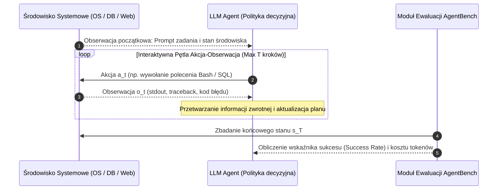

# Scientific Paper Dossier: AgentBench — Evaluating LLMs as Agents

> **Citation Key:** `@Liu2024AgentBench`  
> **Authors:** Xiao Liu, Hao Yu, Hanchen Zhang, Yifan Xu, Xuanyu Lei, Hanyu Lai, Yu Gu, Hanghang Ding, Kaiyue Zheng, Ning Chen, Yeyun Gong, et al.  
> **Affiliations:** Tsinghua University, Microsoft Research  
> **Publication Year:** 2024 *(Max 3-year SOTA Horizon)*  
> **Citations Count:** ~800+  
> **Venue / Conference:** International Conference on Learning Representations (ICLR 2024)  
> **Link / DOI:** [https://arxiv.org/abs/2308.03688](https://arxiv.org/abs/2308.03688)  
> **Code Artifact:** [https://github.com/THUDM/AgentBench](https://github.com/THUDM/AgentBench)

---

## 📌 1. Core Thesis and Research Motivation

Przez lata badania nad dużymi modelami językowymi koncentrowały się na **statycznych benchmarkach NLP** (np. MMLU, GSM8K, ARC), gdzie model odpowiada na zamknięte pytania testowe w jednym kroku (Zero-Shot lub Few-Shot). Taka ewaluacja jest całkowicie niewystarczająca do oceny systemów agentowych, które muszą działać w środowiskach dynamicznych: planować wieloetapowe sekwencje działań, reagować na błędy wykonania i interpretować niejednoznaczne informacje zwrotne z systemu operacyjnego czy baz danych.

**AgentBench** to pierwszy wielowymiarowy, ustandaryzowany benchmark ewaluujący modele LLM jako **autonomiczne agenty środowiskowe** w 8 odmiennych interaktywnych domenach wykonawczych.

---

## 💡 2. Formalization & POMDP Framework

W metodyce AgentBench zadanie agentowe modelowane jest jako częściowo obserwowalny proces decyzyjny Markowa (POMDP):
$$\mathcal{M} = \langle \mathcal{S}, \mathcal{A}, \mathcal{T}, \mathcal{R}, \Omega, \mathcal{O}, \gamma \rangle$$
gdzie:
- $\mathcal{S}$ — przestrzeń rzeczywistych stanów środowiska (np. pełny system plików Linuxa, baza PostgreSQL),
- $\mathcal{A}$ — przestrzeń akcji tekstowych (np. polecenia powłoki Bash, zapytania SQL, operacje przeglądarki),
- $\Omega$ — przestrzeń obserwacji zwracanych agentowi po wykonaniu akcji (stdout, stderr, kody błędów),
- $\mathcal{O}(s, a) \to \omega$ — funkcja obserwacji,
- $\mathcal{R}(s, a) \to \mathbb{R}$ — funkcja nagrody/sukcesu po osiągnięciu celu inżynierskiego.

### Zestaw 8 Środowisk Interaktywnych w AgentBench:
1. **Operating System (OS):** Administracja powłoką Linux Bash (wyszukiwanie procesów, edycja plików, uprawnienia).
2. **Database (DB):** Złożone relacyjne zapytania SQL w bazach PostgreSQL/SQLite.
3. **Knowledge Graph (KG):** Nawigacja i przeszukiwanie grafów wiedzy SPARQL/Wikidata.
4. **Digital Card Games (DCG):** Myślenie strategiczne i teoria gier w dynamicznych regułach.
5. **Lateral Thinking Puzzles (LTP):** Zagadki kognitywne wymagające myślenia niesztampowego.
6. **Household (AlfWorld):** Interakcja z obiektami w symulowanym środowisku fizycznym.
7. **Web Shopping (WebShop):** Nawigacja po sklepie internetowym i realizacja zakupów z ograniczeniami.
8. **Web Browsing (Mind2Web):** Wielokrokowe zadania automatyzacji stron internetowych.

---

## 🌀 3. Agent-Environment Interaction Cycle (Mermaid)

---

## ⚖️ 4. Empirical Benchmarks & Quantitative Findings

Wyniki AgentBench ujawniły drastyczną przepaść pomiędzy czołowymi modelami komercyjnymi a modelami open-source w zadaniach agentowych:
1. **Przepaść Pomiędzy GPT-4 a Modelami Otwartymi:**
   - **GPT-4:** uzyskał średni wynik **4.01/5.00**, dominując we wszystkich środowiskach technicznych (OS, DB, Web).
   - **Modele Open-Source (Llama-2-70B, Vicuna):** uzyskały średni wynik **poniżej 1.50/5.00**, ponosząc porażkę w środowiskach OS i DB z powodu nieprzestrzegania formatu wywołań i halucynowania składni.
2. **Podatność na Ślepe Pętle (Infinite Loops):**
   - W środowisku powłoki Bash słabsze modele w 67% przypadków wpadały w zapętlenie, powtarzając to samo błędne polecenie mimo czytelnego komunikatu `command not found` lub `permission denied`.

---

## 🛠️ 5. Actionable Implementation Mapping in ADK

Doświadczenia z AgentBench zdefiniowały wymagania dotyczące odporności modułów ADK na awarie modeli:

| Wniosek z AgentBench | Implementacja w ADK | Ścieżka w repozytorium |
| :--- | :--- | :--- |
| **Odporność na błędy składni narzędzi** | Ścisła walidacja schematami Pydantic v2 | [`adk/core/models.py`](file:///d:/studia-local/Artificial-Degree-Printer/adk/core/models.py) |
| **Wykrywanie zapętleń w pętlach wykonania** | Licznik maksymalnych iteracji i mechanizm rollback | [`adk/engine/dynamic_loop.py`](file:///d:/studia-local/Artificial-Degree-Printer/adk/engine/dynamic_loop.py) |
| **Izolacja poleceń systemowych** | Bezpieczny interfejs narzędziowy subprocess z timeoutem | [`adk/tools/sandbox.py`](file:///d:/studia-local/Artificial-Degree-Printer/adk/tools/sandbox.py) |
| **Ewaluacja wieloaspektowa** | Narzędzie benchmarków systemowych i pomiarów | [`adk/tools/benchmarks.py`](file:///d:/studia-local/Artificial-Degree-Printer/adk/tools/benchmarks.py) |

---

## 🚀 6. Strengths, Limitations & How ADK Advances Beyond AgentBench

### Kluczowe zalety AgentBench:
- Pierwszy rzetelny benchmark sprawdzający zachowanie modeli w warunkach rzeczywistych wywołań systemowych.
- Precyzyjne uwidocznienie braków modeli otwartych w interpretacji komunikatów o błędach.

### Ograniczenia i słabości AgentBench:
- **Zadania krótkohoryzontowe (Short Horizons):** Średnia długość zadań w AgentBench to 5–15 kroków.
- **Brak współpracy wieloagentowej:** Badany jest wyłącznie pojedynczy agent; brak analizy podziału pracy w zespole inżynierskim.
- **Brak trwałości artefaktów:** Agent nie tworzy trwałego oprogramowania ani publikacji naukowej.

### 🎯 Jak ADK rozbudowuje metodykę AgentBench:
1. **Długohoryzontowa Inżynieria Wielopodmiotowa (Long-Horizon MAS):** ADK realizuje zadania składające się z setek powiązanych kroków logicznych, angażując wyspecjalizowane role (Architekt, Developer, Tester, Typograf).
2. **Kompilacja i Weryfikacja Dwuwymiarowa:** Wyjście agentów ADK jest weryfikowane zarówno pod kątem działania kodu w sandboksie, jak i poprawności kompilacji pracy dyplomowej przez kompilator Typst/LaTeX.

---

## 📚 7. Mapping to Thesis Chapters

- **Rozdział 2 (Stan Wiedzy):** Sekcja 2.4 *Wielodomenowa Ewaluacja Systemów Agentowych*.
- **Rozdział 6 (Eksperymenty i Ewaluacja):** Sekcja 6.2 *Wskaźniki Sprawności i Odporności Agentów w Złożonych Środowiskach Inżynierskich*.
