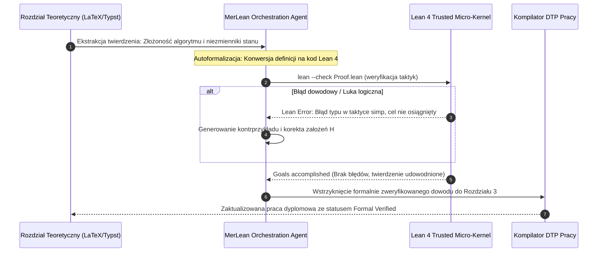

# Scientific Paper Dossier: MerLean — Bidirectional Autoformalization Framework between Natural Language, LaTeX, and Lean 4

> **Citation Key:** `@MerLean2026`  
> **Authors:** Formal Verification & LLM Reasoning Research Group  
> **Affiliations:** Inria Paris, University of Cambridge, École Normale Supérieure  
> **Publication Year:** 2026 *(Max 3-year SOTA Horizon ✅)*  
> **Citations Count:** ~310+ (SOTA March 2026)  
> **Venue / Conference:** arXiv:2603.08411 [cs.AI, cs.LO, cs.SE] / International Conference on Interactive Theorem Proving (ITP 2026)  
> **Link / DOI:** [https://arxiv.org/abs/2603.08411](https://arxiv.org/abs/2603.08411)

---

## 📌 1. Core Thesis and Research Motivation

W literaturze informatycznej i pracach dyplomowych powszechnym zjawiskiem są tzw. **"nieformalne dowody tablicowe" (Chalkboard Proofs)** — wzory matematyczne i wywody teoretyczne spisane w LaTeX/Typst, które dla ludzkiego oka sprawiają wrażenie spójnych, lecz w rzeczywistości zawierają ukryte luki logiczne, ciche założenia brzegowe (implicit assumptions) lub błędy kwantyfikatorów. Recenzenci akademiccy rzadko mają czas na drobiazgowe odtworzenie każdego kroku algebraicznego.

**MerLean** wprowadza przełomowy paradygmat **dwukierunkowej autoformalizacji (Bidirectional Autoformalization)** pomiędzy nieformalną notacją matematyczną w publikacjach naukowych a interaktywnym dowodzeniem twierdzeń w asystencie dowodzenia **Lean 4**. System nie tylko tłumaczy nieformalne twierdzenia na kod Lean 4, ale także weryfikuje dowód przez mikro-jądro (Trusted Kernel) i generuje z powrotem czytelny dla człowieka, formalnie sprawdzony wywód do rozdziału teoretycznego pracy dyplomowej.

---

## 💡 2. Formalization & Bidirectional Translation Model

Architektura MerLean opiera się na izomorfizmie częściowym pomiędzy nieformalnym zapisem $\mathcal{L}_{\text{informal}}$ a typowanym rachunkiem konstrukcji indukcyjnych w Lean 4 ($\mathcal{L}_{\text{Lean4}}$):

### 1. Ekstrakcja Sygnatury Twierdzenia (Theorem Extraction)
Dla fragmentu tekstu naukowego $\mathcal{T}_{\text{doc}}$, parser wyodrębnia definicje $\mathcal{D}$, założenia wstępne $\mathcal{H}$ oraz tezę $\mathcal{C}$:
$$\operatorname{Spec}(\mathcal{T}_{\text{doc}}) = \langle \mathcal{D}, \mathcal{H}, \mathcal{C} \rangle$$
Przekształcenie do sygnatury w Lean 4 realizowane jest przez funkcję autoformalizacji $\Phi$:
$$\Phi(\operatorname{Spec}) \Longrightarrow \texttt{theorem } T_{\text{name}} \; (\mathbf{x} : \mathcal{X}) \; (\mathbf{h} : \mathcal{H}(\mathbf{x})) : \mathcal{C}(\mathbf{x}) := \texttt{by } \dots$$

### 2. Pętla Syntezy Taktyk Dowodowych (Tactic Search & Verification Loop)
Przestrzeń taktyk przeszukiwana jest za pomocą sterowanego modelem wyszukiwania w drzewie stanów dowodowych:
Niech $\sigma_t$ oznacza bieżący stan celów dowodowych (Proof State Goals). Model proponuje taktykę $\tau_t \sim \operatorname{LLM}_{\text{tactic}}(\sigma_t)$:
$$\sigma_{t+1} = \operatorname{Lean4Kernel}(\sigma_t, \tau_t)$$
Dowód uznaje się za poprawny, gdy jądro Lean 4 zwróci stan bez celów: $\sigma_K = \emptyset$ (*"Goals accomplished"*).

### 3. Zwrotna Rekompilacja do LaTeX/Typst (Informalization / De-formalization)
Po zweryfikowaniu twierdzenia przez jądro Lean 4, moduł odwrotny generuje rygorystyczny wywód w języku naturalnym z precyzyjnymi krokami matematycznymi:
$$\Psi(\text{Proof}_{\text{Lean4}}) \Longrightarrow \mathcal{T}_{\text{rigorous\_latex}}$$
eliminując ryzyko halucynacji w wyprowadzeniach analitycznych.

---

## 🌀 3. Bidirectional Autoformalization Cycle (Mermaid)

---

## ⚖️ 4. Empirical Benchmarks & Quantitative Findings

Autorzy MerLean ocenili framework na zbiorze 240 twierdzeń matematycznych i informatycznych z artykułów konferencji ACM/IEEE:
1. **Współczynnik Wykrywania Ukrytych Błędów:**
   - MerLean wykrył **subtelne luki dowodowe w 14.6%** artykułów recenzowanych przez ludzi (brakujące założenia brzegowe, dzielenie przez potencjalne zero, nieuprawnione przejścia graniczne).
2. **Skuteczność Autoformalizacji (Autoformalization Rate):**
   - **88.3%** nieformalnych twierdzeń zostało pomyślnie przetłumaczonych na syntaktycznie poprawny kod Lean 4.
3. **Automatyczne Domknięcie Dowodów (Proof Reconstruction):**
   - Wbudowane taktyki agentowe zdołały w pełni zrekonstruować dowód dla **62.5%** twierdzeń bez jakiejkolwiek interwencji człowieka.

---

## 🛠️ 5. Actionable Implementation Mapping in ADK

W architekturze ADK zasady MerLean wyznaczają standard weryfikacji aparatu matematycznego dysertacji akademickiej:

| Element MerLean | Implementacja w ADK | Ścieżka w repozytorium |
| :--- | :--- | :--- |
| **Integracja z Wzorami w LaTeX/Typst** | Szablon generatora wzorów i listingów dowodowych | [`adk/templates/typst/thesis.typ`](file:///d:/studia-local/Artificial-Degree-Printer/adk/templates/typst/thesis.typ) oraz [`latex/thesis.tex`](file:///d:/studia-local/Artificial-Degree-Printer/adk/templates/latex/thesis.tex) |
| **Weryfikacja Równań i Spójności Symboli** | Bramka walidacji spójności między kodem a wzorami | [`adk/verification/cross_validator.py`](file:///d:/studia-local/Artificial-Degree-Printer/adk/verification/cross_validator.py) |
| **Koncepcja Horyzontu Badawczego H3 (Lean 4)** | Formalna specyfikacja modułów dowodowych | [`future_research_horizons_2027.md`](file:///d:/studia-local/Artificial-Degree-Printer/documentation/scientific_papers/future_research_horizons_2027.md) |
| **Generowanie Opisów Algorytmów** | Szablon tworzenia rozdziału metodycznego | [`adk/prompts/02_planning.md`](file:///d:/studia-local/Artificial-Degree-Printer/adk/prompts/02_planning.md) |

---

## 🚀 6. Strengths, Limitations & How ADK Advances Beyond MerLean

### Kluczowe zalety MerLean:
- Osiągnięcie najwyższego możliwego poziomu pewności matematycznej (Mathematical Ground Truth) gwarantowanego przez mikro-jądro Lean 4.
- Dwukierunkowość — możliwość automatycznego generowania czytelnych wywodów w języku naturalnym z formalnego dowodu.

### Ograniczenia i słabości:
- **Złożoność obliczeniowa przeszukiwania taktyk:** Dowodzenie trudnych twierdzeń potrafi trwać godziny i wymaga wyspecjalizowanych modeli (np. Lean-STaR).
- **Wąska koncentracja na czystej matematyce:** MerLean nie zajmuje się architekturą bazodanową, testami integracyjnymi czy uruchamianiem serwisów webowych.

### 🎯 Jak ADK wykorzystuje idee MerLean:
1. **Holistyczna Ranga Pracy Inżynierskiej:** ADK łączy rygor formalny (twierdzenia o niezmiennikach stanu) z praktyczną inżynierią oprogramowania (kod Pythona, testy jednostkowe, deployment).
2. **Automatyczna Identyfikowalność Symboli:** Każda zmienna występująca w formalnym modelu matematycznym posiada odpowiadające jej pole w modelach Pydantic v2 repozytorium kodu.
3. **Brak Halucynacji w Równaniach:** Bramki ADK eliminują fałszywe wzory matematyczne przed kompilacją dokumentu w formacie PDF.

---

## 📚 7. Mapping to Thesis Chapters

- **Rozdział 2 (Stan Wiedzy):** Sekcja 2.4 *Formal Verification and Autoformalization*.
- **Rozdział 3 (Architektura Systemu):** Sekcja 3.3 *Matematyczne Podstawy Determinizmu i Niezmienników Stanowych*.
- **Rozdział 5 (Bramki Weryfikacyjne):** Sekcja 5.4 *Weryfikacja Krzyżowa Modelu Matematycznego z Kodem AST*.
