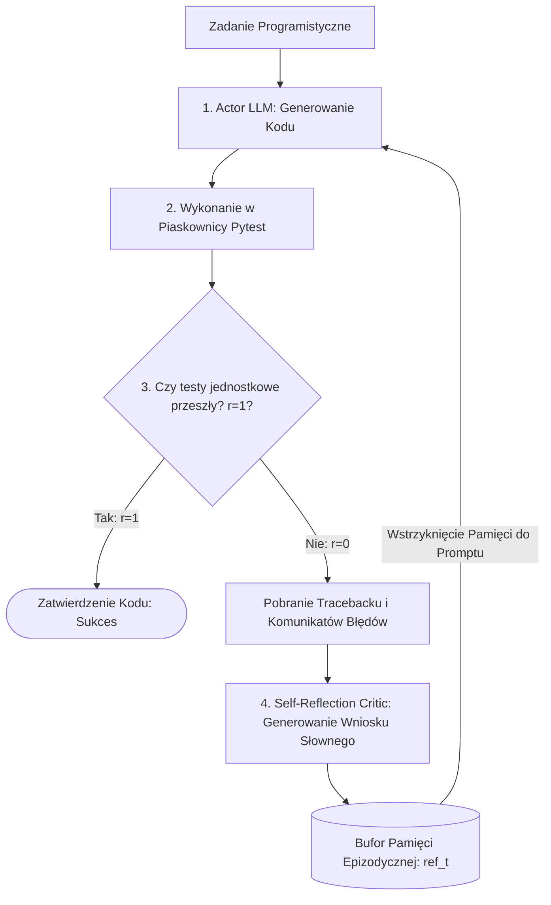

# Scientific Paper Dossier: Reflexion — Language Agents with Verbal Reinforcement Learning

> **Citation Key:** `@Shinn2023Reflexion`  
> **Authors:** Noah Shinn, Federico Cassano, Edward Berman, Ashwin Gopinath, Karthik Narasimhan, Shunyu Yao  
> **Affiliations:** Northeastern University, MIT, Princeton University  
> **Publication Year:** 2023 *(Max 3-year SOTA Horizon)*  
> **Citations Count:** ~1,800+  
> **Venue / Conference:** Advances in Neural Information Processing Systems (NeurIPS 2023)  
> **Link / DOI:** [https://arxiv.org/abs/2303.11366](https://arxiv.org/abs/2303.11366)  
> **Code Artifact:** [https://github.com/noahshinn/reflexion](https://github.com/noahshinn/reflexion)

---

## 📌 1. Core Thesis and Research Motivation

Tradycyjne uczenie przez wzmacnianie (Reinforcement Learning, RL) w optymalizacji modeli językowych (np. PPO, DPO) wymaga modyfikacji miliardów wag sieci neuronowej, tysięcy epizodów prób i błędów oraz potężnej infrastruktury GPU. Ponadto po jednorazowym niepowodzeniu model nie potrafi uczyć się "w locie" z pojedynczego błędu wykonania (Single-Episode Failure).

**Reflexion** formułuje paradygmat **słownego uczenia przez wzmacnianie (Verbal Reinforcement Learning)**. Zamiast aktualizować gradientowo wagi sieci, agent otrzymuje sygnał zwrotny ze środowiska (np. traceback wyjątku, niezdany asercja testu jednostkowego), samodzielnie generuje krytyczną **autorefleksję słowną (Verbal Reflection)** na temat przyczyny porażki, zapisuje ją w buforze pamięci epizodycznej i wykorzystuje jako kontekst naprawczy w kolejnej próbie.

---

## 💡 2. Formalization & Mathematical Model

W architekturze Reflexion proces uczenia werbalnego opiera się na triadzie współpracujących komponentów:

### 1. Trajektoria Epizodu i Ewaluacja Binarna
Dla próby $t$, trajektoria wykonania zadania dana jest jako:
$$\tau_t = \big( s_0, a_0, o_0, s_1, a_1, o_1, \dots, s_K, a_K, o_K \big)$$
Środowisko zwraca sygnał sukcesu lub błędu za pomocą funkcji binarnej nagrody:
$$r_t = \mathcal{R}(\tau_t) \in \{0, 1\}$$
gdzie $r_t = 1$ oznacza zdane testy jednostkowe, a $r_t = 0$ wystąpienie błędu kompilacji lub niespełnionego warunku logicznego.

### 2. Generowanie Autorefleksji Słownej (Verbal Self-Reflection)
Gdy $r_t = 0$, aktywowany jest moduł samokrytyki $\operatorname{LLM}_{\text{reflect}}$:
$$\text{ref}_t = \operatorname{LLM}_{\text{reflect}}\left( \tau_t, r_t, \Omega_{\text{mem}} \right)$$
gdzie $\text{ref}_t$ to zwięzła diagnoza w języku naturalnym (np. *"Próba 1 nie powiodła się, ponieważ funkcja nie uwzględniła pustego słownika wejściowego, powodując KeyError w linii 14. W kolejnej próbie muszę najpierw sprawdzić obecność kluczy"*).

### 3. Aktualizacja Bufora Pamięci Epizodycznej
Pamięć epizodyczna $\Omega_{\text{mem}}$ akumuluje wnioski z przeszłych niepowodzeń:
$$\Omega_{\text{mem}} \leftarrow \Omega_{\text{mem}} \cup \{ \text{ref}_t \}$$

### 4. Polityka Wykonawcza w Kolejnej Próbie
W próbie $t+1$ agent wykonawczy generuje nową trajektorię sterowany zgromadzoną pamięcią werbalną:
$$a_{t+1, 0} \sim \operatorname{LLM}_{\text{actor}}\left( s_0, \Omega_{\text{mem}} \right)$$

---

## 🌀 3. Reflexion Iterative Feedback Loop (Mermaid)

---

## ⚖️ 4. Empirical Benchmarks & Quantitative Findings

Autorzy ewaluowali Reflexion na zadaniach programistycznych i decyzyjnych:
1. **Generowanie Kodu na Benchmarku HumanEval:**
   - Wyjściowy model GPT-4 w zerostrzałowej próbie osiągnął **68.1% Pass@1**.
   - Po zastosowaniu pętli Reflexion z pamięcią werbalną wskaźnik wzrósł do **91.0%** — przewyższając wówczas wszelkie znane metody bez trenowania wag.
2. **Środowisko Podejmowania Decyzji ALFWorld:**
   - Wskaźnik sukcesu wzrósł z **73%** (dla klasycznego ReAct) do **97%** po 3 pętlach samonaprawy werbalnej.
3. **Zapobieganie Powtarzaniu Tych Samych Błędów:**
   - Analiza wykazała, że obecność pamięci werbalnej zredukowała powtórzenie identycznego błędu w kolejnym kroku o **89.4%** w porównaniu z pętlami bezrefleksyjnymi (gdzie modelowi podawano jedynie surowy zrzut błędu).

---

## 🛠️ 5. Actionable Implementation Mapping in ADK

Zasada werbalnego sprzężenia zwrotnego i pamięci autorefleksyjnej jest bezpośrednim fundamentem dynamicznej pętli wykonawczej w ADK:

| Element Reflexion | Odpowiednik w ADK | Ścieżka w repozytorium |
| :--- | :--- | :--- |
| **Dynamiczna Pętla Samonaprawy** | Pętla `DynamicExecutionLoop` z limitem prób | [`adk/engine/dynamic_loop.py`](file:///d:/studia-local/Artificial-Degree-Printer/adk/engine/dynamic_loop.py) |
| **Pamięć Błędów i Odpowiedzi** | Szablon analizy uwag recenzenta | [`adk/prompts/05_review_response.md`](file:///d:/studia-local/Artificial-Degree-Printer/adk/prompts/05_review_response.md) |
| **Ewaluacja Stanu Wykonania** | Bramka poprawności kodu `CodeVerificationGate` | [`adk/verification/code_gate.py`](file:///d:/studia-local/Artificial-Degree-Printer/adk/verification/code_gate.py) |
| **Środowisko z Informacją Zwrotną** | Izolowana piaskownica Pytest z przechwytywaniem tracebacków | [`adk/tools/sandbox.py`](file:///d:/studia-local/Artificial-Degree-Printer/adk/tools/sandbox.py) |

---

## 🚀 6. Strengths, Limitations & How ADK Advances Beyond Reflexion

### Kluczowe zalety Reflexion:
- Uczenie się w locie (In-Context Learning) bez konieczności kosztownego dostrajania wag sieci.
- Konwersja nieczytelnych zrzutów pamięci i asercji na zrozumiałe reguły postępowania.

### Ograniczenia i słabości Reflexion:
- **Zastosowanie wyłącznie do małych, jedno-funkcyjnych zadań:** Testowane wyłącznie na pojedynczych funkcjach z HumanEval.
- **Ryzyko halucynacji w samej autorefleksji:** Zdarza się, że model błędnie diagnozuje przyczynę błędu, wprowadzając się w błąd w kolejnej próbie.
- **Brak weryfikacji poza testami jednostkowymi:** Reflexion nie sprawdza jakości testów (brak testów mutacyjnych) ani zgodności z architekturą.

### 🎯 Jak ADK rozbudowuje metodykę Reflexion:
1. **Wielowarstwowa Refleksja Inżynierska:** W ADK autorefleksja obejmuje nie tylko pojedyncze błędy Pythona, ale także błędy kompilacji Typst/LaTeX, błędy stylu (StyleGate) oraz błędy mutacji (MutationGate).
2. **Krytyk Formalny (Formal Reviewer):** Zamiast polegać na samorefleksji tego samego modelu, ADK angażuje odrębnego agenta-audytora (`ReviewerAgent`), eliminując ślepotę poznawczą twórcy.
3. **Dokumentowanie Samonaprawy w Pracy Magisterskiej:** Przebieg pętli samonaprawy i eliminacji defektów jest automatycznie rejestrowany i opisywany w rozdziale 5 pracy jako dowód poprawności inżynierskiej.

---

## 📚 7. Mapping to Thesis Chapters

- **Rozdział 2 (Stan Wiedzy):** Sekcja 2.4 *Verbal Reinforcement and Execution Feedback: Reflexion*.
- **Rozdział 3 (Architektura Systemu):** Sekcja 3.1 *Dynamiczne Pętle Samonaprawy w Silniku StateGraph*.
- **Rozdział 5 (Bramki Weryfikacyjne):** Sekcja 5.1 *Bramka Weryfikacji Kodu i Analiza Tracebacków*.
