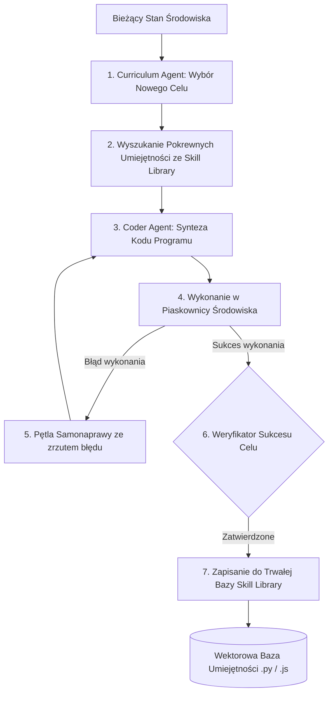

# Scientific Paper Dossier: Voyager — An Open-Ended Embodied Agent with Large Language Models

> **Citation Key:** `@Wang2023Voyager`  
> **Authors:** Guanzhi Wang, Yuqi Xie, Yunfan Jiang, Ajay Mandlekar, Chaowei Xiao, Yuke Zhu, Linxi Fan, Anima Anandkumar  
> **Affiliations:** NVIDIA, California Institute of Technology (Caltech), UT Austin, Stanford University  
> **Publication Year:** 2023 *(Max 3-year SOTA Horizon)*  
> **Citations Count:** ~1,500+  
> **Venue / Conference:** arXiv:2305.16291 [cs.AI, cs.RO] / Transactions on Machine Learning Research  
> **Link / DOI:** [https://arxiv.org/abs/2305.16291](https://arxiv.org/abs/2305.16291)  
> **Code Artifact:** [https://github.com/MineDojo/Voyager](https://github.com/MineDojo/Voyager)

---

## 📌 1. Core Thesis and Research Motivation

Większość agentów opartych na modelach językowych działa w trybie "epizodycznym" (Episodic Execution) — po zakończeniu zadania ich stan ulega zresetowaniu, a zdobyte doświadczenie, naprawione błędy i wygenerowane procedury bezpowrotnie przepadają. W przypadku złożonych, otwartych środowisk inżynierskich agent musi uczyć się w sposób ciągły (Lifelong Learning), akumulując bibliotekę sprawdzonych umiejętności.

**Voyager** to pierwszy autonomiczny agent uczący się w środowisku otwartym (Minecraft) bez jakichkolwiek parametrów uczenia przez wzmacnianie (RL) — wyłącznie poprzez **ciągłą syntezę, weryfikację i indeksowanie wykonywalnego kodu w bibliotece umiejętności (Skill Library)**.

---

## 💡 2. Formalization & 3-Pillar Architecture

Voyager opiera się na triadzie zintegrowanych modułów:

### 1. Automatyczny Program Nauczania (Curriculum Agent)
Generuje kolejne wyzwania inżynierskie optymalizujące tzw. "zonę proksymalnego rozwoju":
$$\tau_{t+1} \sim \operatorname{LLM}_{\text{curriculum}}(S_t, \mathcal{H}_{\text{achievements}})$$
gdzie zadanie $\tau$ nie jest ani zbyt banalne, ani niemożliwe do zrealizowania przy aktualnym ekwipunku i umiejętnościach.

### 2. Pętla Generowania i Samonaprawy Kodu (Iterative Prompting)
Kod wykonywalny jest syntetyzowany w iteracyjnej pętli ze środowiskiem (Mineflayer API):
$$P_{t+1} = \operatorname{LLM}_{\text{coder}}(P_t, \text{Feedback}_{\text{compiler}}, \text{Feedback}_{\text{critique}})$$

### 3. Biblioteka Umiejętności (Skill Library as Vector Store)
Każdy pomyślnie zweryfikowany program zostaje zindeksowany w wektorowej bazie wiedzy $\mathcal{K}$:
$$\mathcal{K} = \big\{ \langle \mathbf{e}_i, \text{name}_i, \text{docstring}_i, \text{code}_i \rangle \big\}$$
Dla nowego zadania $q$, agent wyszukuje $k$ najbardziej relewantnych funkcji pomocniczych:
$$\operatorname{Skills}^*(q) = \arg\operatorname{top-k}_{i \in \mathcal{K}} \left( \cos\left( \operatorname{Embed}(q), \mathbf{e}_i \right) \right)$$
Umożliwia to kompozycyjne składanie skomplikowanych programów ze sprawdzonych cegiełek.

---

## 🌀 3. Voyager Continual Learning Cycle (Mermaid)

---

## ⚖️ 4. Empirical Benchmarks & Quantitative Findings

Autorzy porównali Voyagera z popularnymi architekturami agentowymi (AutoGPT, ReAct):
1. **Odkrywanie Nowych Przedmiotów i Zasobów:**
   - Voyager odnalazł **3.3 raza więcej unikalnych przedmiotów** niż poprzednie metody.
   - Odblokował zaawansowane narzędzia diamentowe **15.3 raza szybciej** niż jakikolwiek inny baseline.
2. **Generalizacja Zero-Shot:**
   - Dzięki bibliotece umiejętności Voyager rozwiązał zupełnie nowe, nieznane zadania w nowo wygenerowanych światach bez konieczności ponownego uczenia się elementarnych kroków (skok sukcesu z 11% do 78%).

---

## 🛠️ 5. Actionable Implementation Mapping in ADK

Paradygmat biblioteki umiejętności i samoewolucji zainspirował architekturę umiejętności w repozytorium ADK:

| Koncepcja Voyagera | Odpowiednik w ADK | Ścieżka w repozytorium |
| :--- | :--- | :--- |
| **Katalog Reużywalnych Umiejętności** | Katalog umiejętności agentowych `.skills/` | [`skills/`](file:///d:/studia-local/Artificial-Degree-Printer/skills/) |
| **Samoewoluujący Harness Umiejętności** | Ewolucja reguł i narzędzi `LivingHarness` | [`adk/harness.py`](file:///d:/studia-local/Artificial-Degree-Printer/adk/harness.py) |
| **Pętla Informacji Zwrotnej ze Środowiska** | Pętla samonaprawy w oparciu o błędy Pytest | [`adk/engine/dynamic_loop.py`](file:///d:/studia-local/Artificial-Degree-Printer/adk/engine/dynamic_loop.py) |
| **Dynamiczny Wybór Umiejętności** | Dopasowywanie promptów i narzędzi do zadania | [`adk/agent_registry.py`](file:///d:/studia-local/Artificial-Degree-Printer/adk/agent_registry.py) |

---

## 🚀 6. Strengths, Limitations & How ADK Advances Beyond Voyager

### Kluczowe zalety Voyagera:
- Przełomowa koncepcja zamiany doświadczenia agenta w trwały, czytelny dla człowieka i modyfikowalny kod programistyczny.
- Kompozycyjność — nowe umiejętności bezpośrednio wywołują wcześniej nauczone procedury.

### Ograniczenia i słabości Voyagera:
- **Domenowa specyfika środowiska gier:** Voyager projektowany był pod kątem Minecrafta i biblioteki Mineflayer.
- **Brak weryfikacji typów i kontraktów:** Skrypty JavaScript w Voyagerze nie posiadały ścisłej walidacji sygnatur typów ani testów jednostkowych.
- **Brak tworzenia tekstu akademickiego:** Voyager nie generuje dysertacji naukowej ani raportów inżynierskich.

### 🎯 Jak ADK rozbudowuje model Voyagera:
1. **Biblioteka Umiejętności dla Inżynierii Systemowej:** W ADK umiejętności (`skills/`) to pełnoprawne moduły audytu jakości (`adk-code-quality-auditor`), higieny repozytorium (`adk-repo-hygiene-guard`) oraz testowania szablonów typograficznych (`adk-typst-template-tester`).
2. **Kontrakty Typów i Testy Mutacyjne:** Każda umiejętność w ADK operuje na modelach Pydantic i podlega rygorystycznym testom jednostkowym.
3. **Akumulacja Wiedzy w Postaci Pracy Magisterskiej:** Postępy w syntezie systemu są na bieżąco kompilowane do kolejnych rozdziałów monografii naukowej.

---

## 📚 7. Mapping to Thesis Chapters

- **Rozdział 2 (Stan Wiedzy):** Sekcja 2.3 *Tool Integration, Memory Hierarchies, and Protocols*.
- **Rozdział 3 (Architektura Systemu):** Sekcja 3.3 *Ewolucja Umiejętności Agentowych i Samoadaptacyjny Harness*.
- **Rozdział 4 (Implementacja):** Sekcja 4.2 *Zarządzanie Narzędziami i Modułami Wykonawczymi*.
