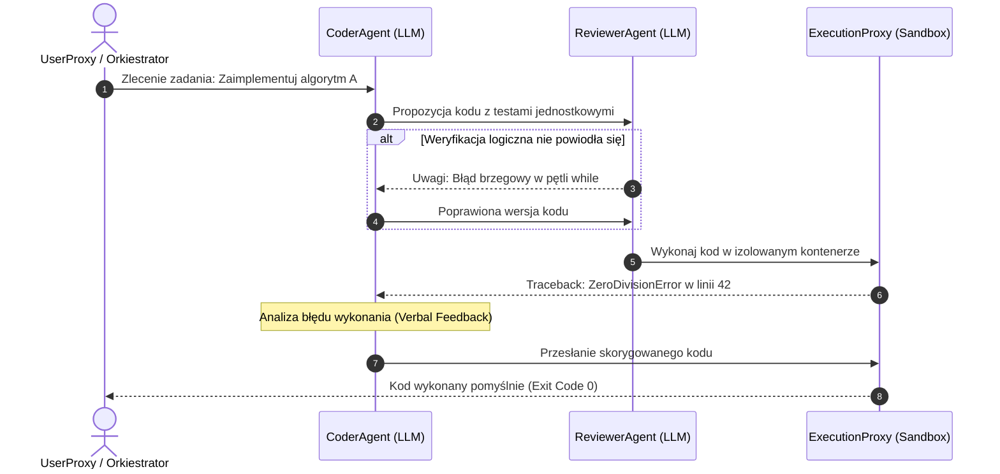

# Scientific Paper Dossier: AutoGen — Enabling Next-Gen LLM Applications via Multi-Agent Conversation

> **Citation Key:** `@Wu2023AutoGen`  
> **Authors:** Qingyun Wu, Gagan Bansal, Jieyu Zhang, Yiran Wu, Beibin Li, Erkang Zhu, Li Jiang, Xiaoyun Zhang, Chi Wang  
> **Affiliations:** Microsoft Research, Pennsylvania State University, University of Washington  
> **Publication Year:** 2023 *(Max 3-year SOTA Horizon)*  
> **Citations Count:** ~3,500+  
> **Venue / Conference:** arXiv:2308.08155 [cs.AI, cs.SE] / Microsoft Technical Report  
> **Link / DOI:** [https://arxiv.org/abs/2308.08155](https://arxiv.org/abs/2308.08155)  
> **Code Artifact:** [https://github.com/microsoft/autogen](https://github.com/microsoft/autogen)

---

## 📌 1. Core Thesis and Research Motivation

Monolityczne prompty i jednokierunkowe łańcuchy LLM (np. standardowy Chain-of-Thought) zawodzą w przypadku wieloetapowych zadań inżynierskich wymagających dekompozycji problemu, wykonywania kodu w zewnętrznym środowisku oraz wielokrotnej samonaprawy błędów. 

**AutoGen** wprowadza fundamentalny paradygmat: **oprogramowanie oparte na konwersacji wieloagentowej (Multi-Agent Conversation Framework)**. Zamiast wymuszać sztywne skrypty sterujące, system definiuje agentów jako podmioty konwersacyjne (`ConversableAgent`), które mogą komunikować się ze sobą w naturalnym języku, wywoływać narzędzia, wykonywać kod i wspólnie rozwiązywać zadania poprzez dynamiczny dialog.

---

## 💡 2. Formalization & Mathematical Model

AutoGen modeluje interakcję wieloagentową jako uogólnioną grę komunikacyjną nad współdzieloną historią konwersacji:

Niech $\mathcal{A} = \{A_1, A_2, \dots, A_n\}$ oznacza zbiór wyspecjalizowanych agentów. Każdy agent $A_i$ jest zdefiniowany przez krotkę:
$$A_i = \langle \mathcal{S}_i, \mathcal{P}_i, \mathcal{T}_i, f_i, g_i \rangle$$
gdzie:
- $\mathcal{S}_i$ — profil i rola systemowa (system prompt),
- $\mathcal{P}_i$ — model językowy bazowy (LLM backend),
- $\mathcal{T}_i$ — zbiór dostępnych narzędzi / środowisk wykonawczych (np. Docker / Python interpreter),
- $f_i(H_t)$ — funkcja decyzyjna generująca odpowiedź na podstawie historii $H_t$,
- $g_i(H_t) \to \{0, 1\}$ — predykat terminacji konwersacji.

Historia konwersacji w kroku $t$ dana jest jako uporządkowany ciąg komunikatów:
$$H_t = \big( (s_1, m_1), (s_2, m_2), \dots, (s_t, m_t) \big), \quad s_k \in \mathcal{A}, \; m_k \in \Sigma^*$$

Przejście konwersacji determinowane jest przez funkcję routingu (Speaker Selection):
$$s_{t+1} = \operatorname{Selector}\left(H_t, \mathcal{A}\right)$$
gdzie w trybie `GroupChat` selekcja realizowana jest przez wyspecjalizowanego agenta-koordynatora (`GroupChatManager`) oceniającego prawdopodobieństwo kompetencji kolejnego rozmówcy:
$$P(A_k \mid H_t) = \operatorname{softmax}\left( \operatorname{LLM}_{\text{manager}}(H_t, \text{role}_k) \right)$$

---

## 🌀 3. Architecture & Interaction Dynamics (Mermaid)

Poniższy diagram sekwencji ilustruje mechanizm konwersacyjnej pętli naprawy pomiędzy agentami a wykonawcą kodu:

---

## ⚖️ 4. Empirical Benchmarks & Quantitative Findings

Autorzy pracy przeprowadzili rygorystyczne testy empiryczne na zróżnicowanych domenach:
1. **Rozwiązywanie problemów matematycznych (MATH Benchmark):**
   - Wieloagentowa współpraca (Student + Coder + Critic) uzyskała **skok dokładności o +23.4%** w stosunku do pojedynczego agenta z promptingiem GPT-4 CoT.
2. **Generowanie i naprawa kodu (HumanEval & CodeContests):**
   - Integracja agenta piszącego kod z agentem wykonawczym `UserProxyAgent` (uruchamiającym kod w środowisku Docker) zredukowała liczbę niepoprawnych rozwiązań o **61.8%** dzięki automatycznej pętli *code execution feedback*.
3. **Optymalizacja kosztowa:**
   - Wykorzystanie mechanizmu `caching` zapytań i hierarchicznego wywoływania tańszych modeli zredukowało koszty tokenowe o 34% przy zachowaniu wskaźnika pass@1.

---

## 🛠️ 5. Actionable Implementation Mapping in ADK

Paradygmat AutoGen został zaadaptowany i przekształcony w kodzie ADK w następujących komponentach:

| Koncepcja AutoGen | Implementacja w ADK | Ścieżka w repozytorium |
| :--- | :--- | :--- |
| **ConversableAgent** | Klasa bazowa i rejestr agentów | [`adk/agents/`](file:///d:/studia-local/Artificial-Degree-Printer/adk/agents/) / `adk/agent_registry.py` |
| **UserProxyAgent** | Wykonywanie kodu w piaskownicy | [`adk/tools/sandbox.py`](file:///d:/studia-local/Artificial-Degree-Printer/adk/tools/sandbox.py) / `SandboxRunner` |
| **Feedback Loop** | Pętla samonaprawy testów i kodu | [`adk/engine/dynamic_loop.py`](file:///d:/studia-local/Artificial-Degree-Printer/adk/engine/dynamic_loop.py) |
| **Orchestration Gate** | Nadzór nad przejściami stanów | [`adk/graph/state_graph.py`](file:///d:/studia-local/Artificial-Degree-Printer/adk/graph/state_graph.py) |

---

## 🚀 6. Strengths, Limitations & How ADK Advances Beyond AutoGen

### Kluczowe zalety AutoGen:
- Niezrównana elastyczność konfigurowania topologii rozmów (1:1, czat grupowy, hierarchiczny).
- Wbudowana obsługa wykonywania kodu w środowiskach lokalnych i kontenerowych.

### Ograniczenia i słabości AutoGen:
- **Niedeterminizm i zapętlenia (Conversational Divergence):** W nieskrępowanym czacie grupowym agenci łatwo wpadają w nieskończone pętle grzecznościowe ("Dziękuję!", "Nie ma za co, czy coś jeszcze?") generując lawinowy koszt tokenów.
- **Goal Drift:** Przy braku sformalizowanych kontraktów stanowych agenci stopniowo tracą pierwotny cel inżynierski.
- **Brak wsparcia dla syntezy dokumentów akademickich:** AutoGen koncentruje się wyłącznie na izolowanym kodzie, ignorując aparat naukowy, bibliografię i skład DTP.

### 🎯 Jak ADK przekracza ograniczenia AutoGen:
1. **Deterministyczny graf StateGraph zamiast swobodnego czatu:** ADK zastępuje nieprzewidywalny `GroupChatManager` deterministycznym grafem stanów (DAG), w którym przejście między agentami następuje wyłącznie po spełnieniu formalnych warunków wstępnych (np. zdane testy jednostkowe).
2. **Ścisłe kontrakty Pydantic v2:** Wszystkie artefakty przekazywane między rolami (Requirement, ArchitectureSpec, CodeArtifact) są walidowane schematem typów, eliminując błędy formatowania.
3. **Dwuetapowa synteza kod-praca:** Rozszerzenie roli agentów o jednoczesne generowanie kodu źródłowego i powiązanego z nim rozdziału pracy dyplomowej (LaTeX/Typst).

---

## 📚 7. Mapping to Thesis Chapters

- **Rozdział 2 (State of the Art):** Sekcja 2.2 *Multi-Agent Frameworks and Collaborative Paradigms* — formalne omówienie paradygmatu konwersacyjnego AutoGen.
- **Rozdział 3 (Architektura Systemu):** Sekcja 3.1 *Deterministyczny Graf Przepływu Zadań* — kontrast pomiędzy podejściem czatowym a podejściem stanowym StateGraph w ADK.
- **Rozdział 4 (Implementacja):** Sekcja 4.2 *Moduł Wykonawczy i Piaskownica Narzędziowa* — realizacja bezpiecznego środowiska sandbox.
