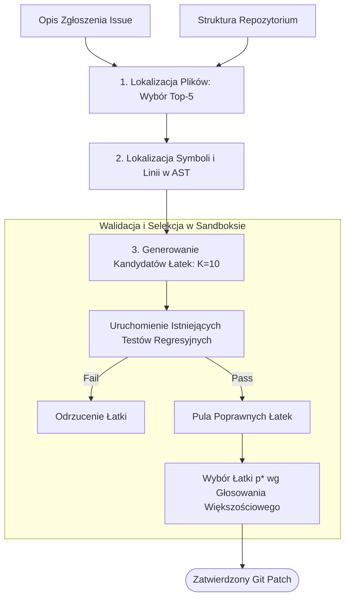

# Scientific Paper Dossier: Agentless — Demystifying LLM-based Software Engineering Agents

> **Citation Key:** `@Xia2024Agentless`  
> **Authors:** Chunqiu Steven Xia, Yinlin Deng, Soren Dunn, Lingming Zhang  
> **Affiliations:** University of Illinois Urbana-Champaign (UIUC)  
> **Publication Year:** 2024 *(Max 3-year SOTA Horizon)*  
> **Citations Count:** ~280+  
> **Venue / Conference:** arXiv:2407.01489 [cs.SE, cs.AI]  
> **Link / DOI:** [https://arxiv.org/abs/2407.01489](https://arxiv.org/abs/2407.01489)  
> **Code Artifact:** [https://github.com/OpenAutoCoder/Agentless](https://github.com/OpenAutoCoder/Agentless)

---

## 📌 1. Core Thesis and Research Motivation

W latach 2023–2024 w społeczności AI zapanowała fascynacja wysoce autonomicznymi rojami agentów (np. AutoGen, SWE-agent, Devin), które w swobodnych pętlach decyzyjnych przeglądały repozytoria, wywoływały powłokę basha i samodzielnie decydowały o kolejnych krokach. Podejścia te charakteryzowały się jednak gigantycznymi kosztami tokenów, długim czasem wykonania oraz tendencją do wpadania w pętle nieskończone.

**Agentless** stawia prowokacyjną, lecz rygorystycznie udowodnioną tezę: **złożone, autonomiczne roje agentów nie są konieczne do rozwiązywania problemów inżynierii oprogramowania**. Autorzy wykazują, że prosty, deterministyczny, trójetapowy potok (Lokalizacja defektu $\to$ Generowanie łatki $\to$ Selekcja i weryfikacja łatki) przewyższa skomplikowane systemy wieloagentowe pod względem skuteczności, będąc jednocześnie o rząd wielkości tańszym i szybszym.

---

## 💡 2. Formalization & Mathematical Model

Potok Agentless modelowany jest jako trójfazowy proces optymalizacyjny z precyzyjnym zawężaniem przestrzeni poszukiwań:

### 1. Faza Lokalizacji Defektu (Hierarchical Fault Localization)
Dla repozytorium $\mathcal{R}$ i opisu problemu $I$ (GitHub Issue), lokalizacja przebiega dwupoziomowo:
- **Poziom plików:** Model wybiera podzbiór podejrzanych plików:
  $$\mathcal{F}_{\text{susp}} = \operatorname{LLM}_{\text{loc-file}}(\mathcal{S}_{\text{tree}}(\mathcal{R}), I), \quad |\mathcal{F}_{\text{susp}}| \le 5$$
- **Poziom funkcji / linii:** Dla każdego $f \in \mathcal{F}_{\text{susp}}$, model wskazuje dokładne przedziały linii kodu:
  $$\mathcal{L}_{\text{susp}} = \operatorname{LLM}_{\text{loc-line}}(\operatorname{AST\_Skeleton}(f), I)$$

### 2. Faza Generowania Łatki (Patch Generation)
Dla zlokalizowanego kontekstu generowana jest próbka $K$ kandydujących łat (gdzie typowo $K \in [5, 10]$):
$$\mathcal{P} = \{ p_1, p_2, \dots, p_K \}, \quad p_i \sim \operatorname{LLM}_{\text{patch}}(\mathcal{L}_{\text{susp}}, I, \text{Temperature}=0.8)$$

### 3. Faza Selekcji i Weryfikacji (Patch Filtering & Ranking)
Wszystkie łatki $p_i$ poddawane są deterministycznym testom regresyjnym w izolowanym środowisku:
$$\operatorname{Valid}(\mathcal{P}) = \{ p \in \mathcal{P} \mid \operatorname{RunTests}(\mathcal{R} \oplus p, \mathcal{T}_{\text{existing}}) = \text{PASS} \}$$
Jeśli zbiór $\operatorname{Valid}(\mathcal{P})$ zawiera więcej niż jedną łatkę, ostateczny wybór $p^*$ determinowany jest za pomocą turnieju większościowego (Majority Voting) lub testów reprodukcyjnych wygenerowanych z opisu $I$.

---

## 🌀 3. Agentless Tri-Stage Pipeline (Mermaid)

---

## ⚖️ 4. Empirical Benchmarks & Quantitative Findings

Autorzy ocenili Agentless na oficjalnym benchmarku **SWE-bench Lite** (300 rzeczywistych problemów z czołowych repozytoriów Python: Django, SymPy, Matplotlib itp.):
1. **Wskaźnik Rozwiązanych Problemów (Resolve Rate):**
   - Agentless uzyskał wynik **27.33%** (z modelem GPT-4o), przewyższając zaawansowane frameworki agentowe: SWE-agent (18.0%), AutoCodeRover (19.0%) oraz Devin w momencie publikacji.
2. **Koszty Tokenowe i Czasowe:**
   - Średni koszt naprawy pojedynczego problemu w Agentless: **0.34 USD** (w porównaniu do 2.50 – 5.00 USD w SWE-agent oraz ponad 20 USD w komercyjnych rozwiązaniach).
   - Średni czas wykonania: **2.5 minuty** (wobec 15–30 minut błądzenia agentów wyposażonych w interaktywny terminal Bash).

---

## 🛠️ 5. Actionable Implementation Mapping in ADK

Filozofia Agentless (determinizm, eliminacja niekontrolowanego błądzenia agentów i etapowa selekcja) stanowi fundament silnika orkiestracji ADK:

| Zasada Agentless | Implementacja w ADK | Ścieżka w repozytorium |
| :--- | :--- | :--- |
| **Brak swobodnego błądzenia w bashu** | Ściśle kontrolowane narzędzia i sandboxy | [`adk/tools/sandbox.py`](file:///d:/studia-local/Artificial-Degree-Printer/adk/tools/sandbox.py) |
| **Hierarchiczna lokalizacja błędów** | Analiza tracebacków i precyzyjne wskazywanie plików | [`adk/verification/code_gate.py`](file:///d:/studia-local/Artificial-Degree-Printer/adk/verification/code_gate.py) |
| **Wielokrotne próbkowanie i selekcja** | Ewaluacja wariantów z krytyczną bramką testową | [`adk/engine/dynamic_loop.py`](file:///d:/studia-local/Artificial-Degree-Printer/adk/engine/dynamic_loop.py) |
| **Deterministyczny graf faz** | Zastąpienie pętli nieskończonych acyklicznym DAG | [`adk/graph/state_graph.py`](file:///d:/studia-local/Artificial-Degree-Printer/adk/graph/state_graph.py) |

---

## 🚀 6. Strengths, Limitations & How ADK Advances Beyond Agentless

### Kluczowe zalety Agentless:
- Obalenie mitu o konieczności stosowania wielopodmiotowych, chaotycznych konwersacji do inżynierii kodu.
- Wybitna efektywność kosztowa i czasowa.
- Powtarzalność i determinizm procesu.

### Ograniczenia i słabości Agentless:
- **Zorientowanie wyłącznie na lokalne łatki (Bug Fixing):** Agentless potrafi jedynie zmodyfikować kilka linii w istniejącym pliku — jest bezradny wobec zadania syntezy **nowego systemu od podstaw (Greenfield Software Synthesis)**.
- **Brak wsparcia dla architektury i projektowania:** Brak fazy analizy wymagań, tworzenia modeli danych i diagramów.
- **Całkowity brak generowania pracy dyplomowej:** Brak modułu pisania dysertacji akademickiej.

### 🎯 Jak ADK łączy zalety Agentless z pełną syntezą systemową:
1. **Zastosowanie determinizmu Agentless do Greenfield Development:** ADK nie pozwala agentom na chaotyczne decydowanie o kolejności kroków — proces wytwarzania projektu i pracy dyplomowej prowadzony jest w ścisłym, deterministycznym grafie fazowym.
2. **Architektura + Kod + Praca:** W przeciwieństwie do wąskiego naprawiania pojedynczych bugów w cudzym kodzie, ADK generuje kompletną architekturę, implementację, testy oraz 80-stronicową monografię naukową.
3. **Bramki Weryfikacyjne z Testami Mutacyjnymi:** Selekcja wygenerowanego kodu w ADK weryfikowana jest nie tylko testami jednostkowymi, lecz także wskaźnikiem zabitych mutantów (Mutation Score).

---

## 📚 7. Mapping to Thesis Chapters

- **Rozdział 2 (Stan Wiedzy):** Sekcja 2.1 *Evolution of LLM-Driven Software Engineering Agents* — omówienie kontrastu pomiędzy swobodnymi agentami a deterministycznym potokiem Agentless.
- **Rozdział 3 (Architektura Systemu):** Sekcja 3.1 *Deterministyczny Graf Przepływu Zadań i Eliminacja Chaotycznych Pętli*.
- **Rozdział 6 (Eksperymenty i Ewaluacja):** Sekcja 6.2 *Porównanie Kosztów i Czasu Wykonania z Złożonymi Frameworkami MAS*.
